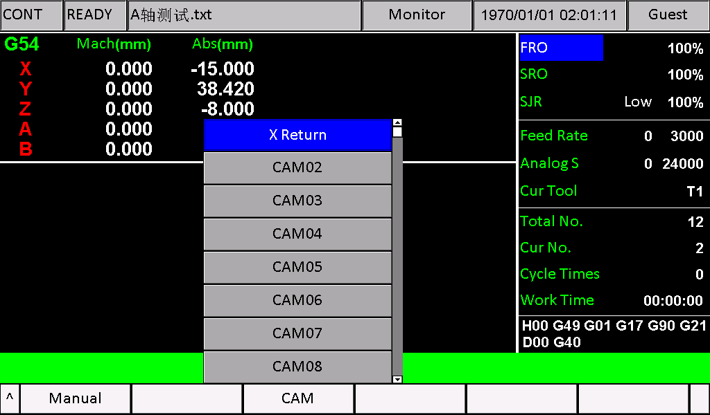
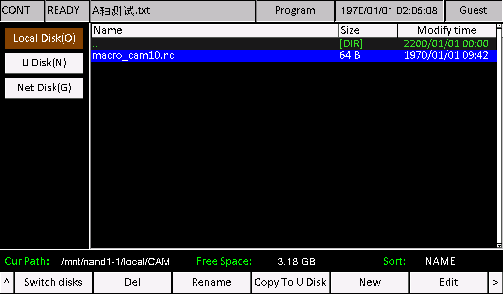
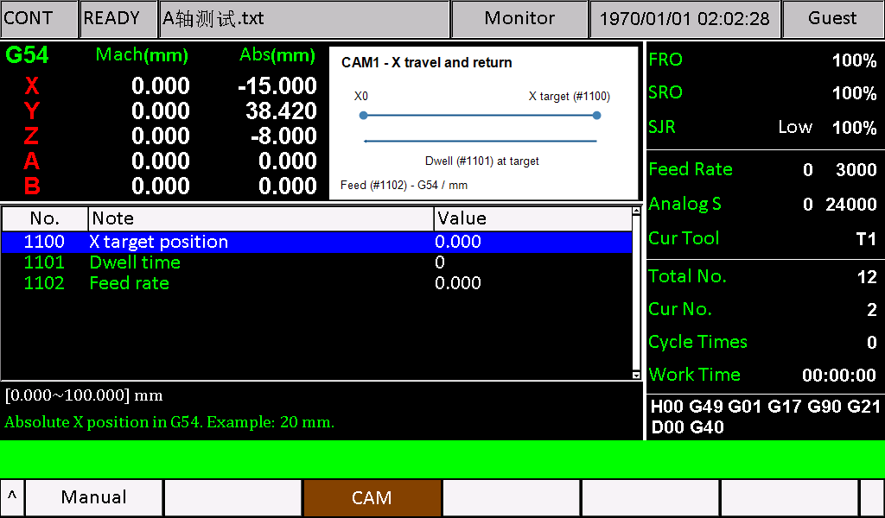
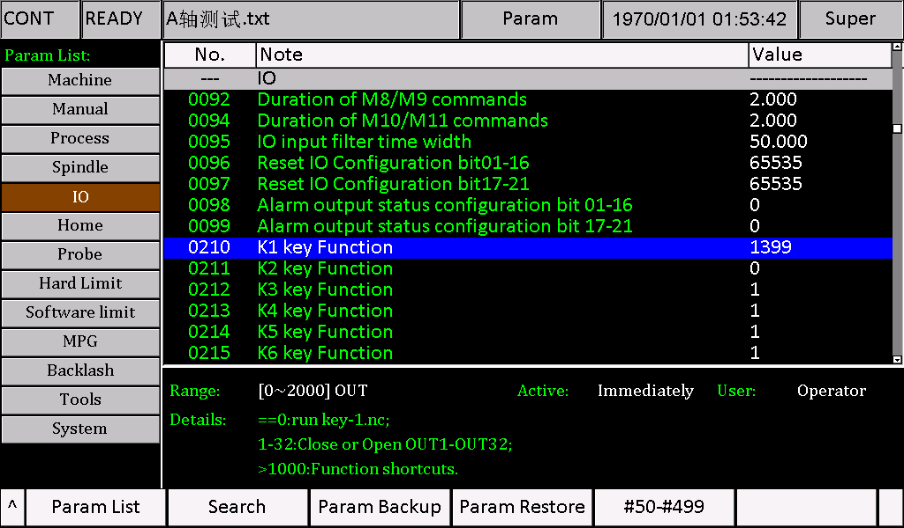
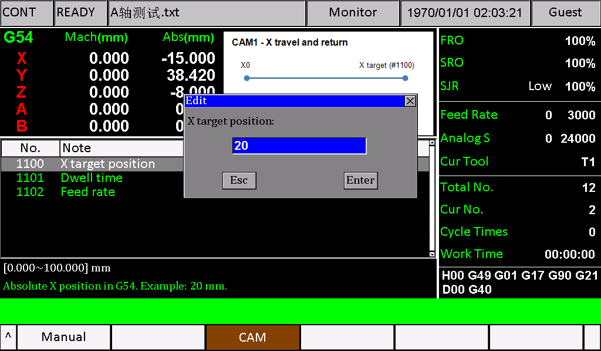
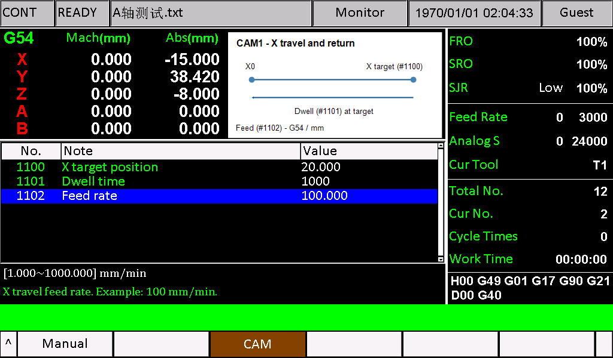
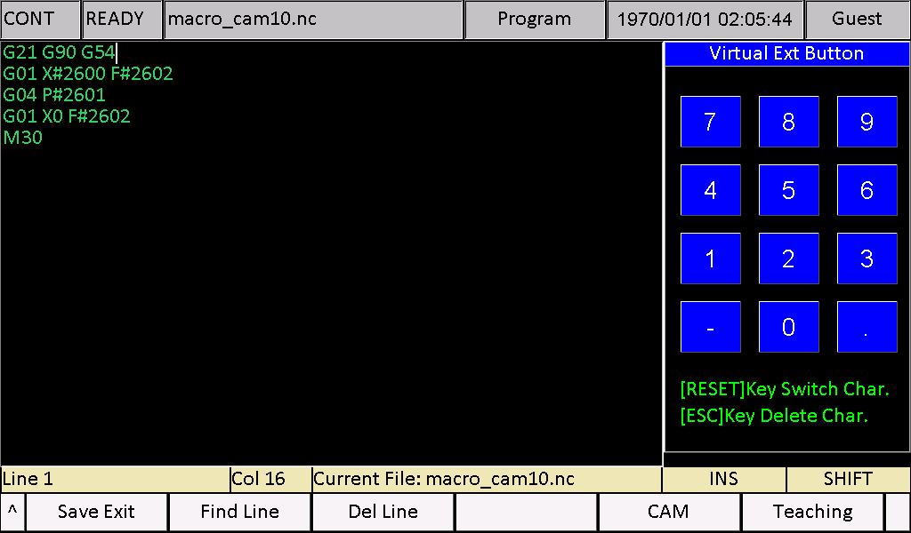

# M350 Custom CAM User Guide

English | [简体中文](README.zh-CN.md)

Software: **2024-03-28-00 and later (inclusive)**. Hardware: **M350 V1 and V2**.

Custom CAM connects a parameter page to an NC program. The operator selects a project, enters its parameters, and presses the machine Start key. The NC program defines the motion; the parameter page does not generate toolpaths.

This guide uses **CAM1 — X Return**, an X-axis travel-and-return example. For a configured machine, go to section 6. First-time setup requires installing the resources and copying the NC program separately.

## Version scope and configuration-file baseline

This guide applies to **2024-03-28-00 and later, including 2024-03-28-00**, on M350 V1 and V2. That version introduced automatic macro parsing for filenames beginning with macro and the macro_camNN.nc CAM entry naming rule.

**Always modify the complete parameter and string configuration files from the upgrade package for the software version actually used by the user. Do not install the bundled example eng or msg1 files.** They are complete reference files from **2026-10-23-05 (October 23, 2026)**, not replacements for other versions or customized machine resources. Preserve existing machine customizations when applying the CAM changes.

Procedure: identify the installed version and hardware, obtain its matching upgrade package, select the language resources using parameter 240, copy those original files to a working folder, and edit only the required CAM parameter definitions and menu entries. Install your modified version-matched files with the diagram, then copy the NC program separately to local/CAM. The USB layouts below show the destinations for your modified files, not an instruction to copy the example configuration files.

The linked 2026-10-23-05 release is the example baseline; it is not the minimum required version. Parameter 240 = 3 (Other/UTF-8) was added in **2024-12-12-00**. Earlier versions must use their available language options. The example program and screenshots use 2026-10-23-05. Check the NC instructions for the installed version before running the example.

## Start here: download and installation order

Download the matching controller upgrade package from [M350 2026-10-23-05 releases](https://github.com/foinnc/M350/releases/tag/2026-10-23-05). Select the **V1 package for V1 hardware** or the **V2 package for V2 hardware**. The GitHub source-code archives are not controller upgrade packages.

For first-time setup, follow this order: **back up → upgrade the controller if necessary → install the CAM example resources → copy the NC program → configure K1 → enter values → check the motion route → start**. A supported controller does not need to be upgraded to the example version solely to use this guide. Use the machine's normal upgrade procedure for the controller package; this guide describes the CAM resources separately.

Download this guide folder with its `CAM1-Example` subfolder, then extract the downloaded files on the computer. Do not copy a GitHub HTML page as `eng` or `msg1`. Do not install the example eng/msg1. Apply their CAM edits to the complete original configuration files from the actual software version upgrade package, preserving existing customizations. Install the example resources after the base upgrade so that the base package does not overwrite them.

The supplied example uses the **English interface**: `eng` defines parameters and `msg1` defines menu text. Other languages use different resource files. Before customizing another language, identify both actual filenames for that version; do not apply the English filenames universally or simply rename the English files.

### Parameter 240: select the correct language resources

Parameter **240 — Language** determines which two resources the controller loads:

| Parameter 240 | Interface language | Parameter definitions | Menu and message text |
| --- | --- | --- | --- |
| 0 | English | `eng` | `msg1` |
| 1 | Chinese | `chs` | `msg` |
| 2 | Russian | `rus` | `msg2` |
| 3 | Other (UTF-8) | `cfg_utf8` | `msg_utf8` |

For the selected language, edit CAM parameter definitions in the third column and CAM menu entries in the fourth column. The CAM1 menu entry remains #647; subsequent items follow the same numbering. Preserve the encoding and line endings of each original file; the Other option uses UTF-8 resources. Install both resources under USB `install/` for V1 or `psys/` for V2. Restart after changing parameter 240 or installing the resources, then check both the menu and parameter page.

The supplied example contains **English resources only** and requires **240 = 0**. For another language, adapt the definitions and menu text in that language's existing complete files; modifying `eng`/`msg1` will not update its active CAM interface. Selecting Other does not translate text automatically: the displayed language depends on the contents of `cfg_utf8` and `msg_utf8`.

### USB layout for the CAM example

Use only the resource directory for your hardware. These trees show the CAM example files, not the full controller upgrade package.

**V1 USB root:**

```text
install/
├── eng
├── msg1
└── CAM/
    └── cam10.bmp
CAM/
└── macro_cam10.nc
```

**V2 USB root:**

```text
psys/
├── eng
├── msg1
└── CAM/
    └── cam10.bmp
CAM/
└── macro_cam10.nc
```

The root-level `CAM` folder is the source for copying the NC program to local storage. The `install/CAM` or `psys/CAM` folder supplies the diagram for resource installation. Do not copy the whole `CAM1-Example` folder into the upgrade directory.

### Check installation before starting

| Where to look | Expected result |
| --- | --- |
| Parameter 210 | `1399` |
| Menu opened with panel K1 | First item is `X Return` |
| X Return parameter page | Upright diagram and parameters 1100, 1101, 1102 |
| Local disk → CAM | `macro_cam10.nc` |
| Values after confirming each entry | `20.000`, `1000`, `100.000` |

If an item is missing, use the troubleshooting table before pressing Start. A menu name or diagram alone does not confirm the NC file has been installed.

## 1. Example files and preparation

The [CAM1-Example](CAM1-Example/) folder contains four files that work together:

| File | Purpose | Destination |
| --- | --- | --- |
| [msg1](CAM1-Example/msg1) | 2026-10-23-05 English menu reference; names the first project X Return | USB: V1 `install/`; V2 `psys/` |
| [eng](CAM1-Example/eng) | 2026-10-23-05 English parameter reference with parameters 1100–1102 | USB: V1 `install/`; V2 `psys/` |
| [cam10.bmp](CAM1-Example/cam10.bmp) | X-axis travel diagram | USB: V1 `install/CAM/`; V2 `psys/CAM/` |
| [macro_cam10.nc](CAM1-Example/macro_cam10.nc) | Move to the target, dwell, and return to X0 | Controller: `local/CAM/` |

1. Confirm software version 2024-03-28-00 or later and identify V1 or V2 hardware.
2. Back up existing menu and language resources, CAM images, programs, and parameters. Compare existing customizations before replacing files.
3. Place your modified version-matched parameter and string configuration files and `cam10.bmp` in the USB resource directories for your hardware. Install through the system update function, then restart. This example contains no firmware binaries; do not add out files from another version.
4. Set parameter 240 to `0` (English), then restart to apply it. The supplied parameter definitions modify `eng` only.
5. Copy the NC file into the controller's local CAM folder as described in section 3.
6. Set parameter 210 to 1399, then open X Return with K1 while machining is stopped.
7. Enter and confirm the example values before any motion test.

The complete `eng` and `msg1` reference files are for **M350_2026-10-23-05**. Installation does not initialize the three parameter values; enter and confirm them before running the example.

## 2. Project names and file mapping

The first menu item uses file number 10. Changing its displayed name does not change its files or parameter group.

| Project | Menu entry in msg1 | Image | NC program | Group |
| --- | --- | --- | --- | --- |
| CAM1 / X Return | #647 | `cam10.bmp` | `macro_cam10.nc` | `-m30` |
| CAM2 | #648 | `cam11.bmp` | `macro_cam11.nc` | `-m31` |
| CAM3 | #649 | `cam12.bmp` | `macro_cam12.nc` | `-m32` |
| CAM10 | #656 | `cam19.bmp` | `macro_cam19.nc` | `-m39` |
| CAM30 | #676 | `cam39.bmp` | `macro_cam39.nc` | `-m59` |

There are 30 menu choices. For item n, the image/program number is n+9, the parameter group is n+29, and the menu text entry is #646+n. A visible menu item does not mean its resources have been configured.



### Rename a project

For the English interface, edit the relevant entry in the existing complete `msg1`. For another language, use its confirmed menu-text resource. The example changes:

```text
#647 "CAM01"
```

to:

```text
#647 "X Return"
```

Keep the original encoding and line endings. Never replace the complete resource with a one-line fragment. Install `msg1` through USB `install/msg1` on V1 or `psys/msg1` on V2, restart, and check the menu.

### Prepare a diagram

Use a **360 × 180 pixel, 24-bit, uncompressed BMP with the standard 54-byte header layout**. Use a lowercase filename such as `cam10.bmp`.

Create the diagram in its normal orientation, then flip the entire image vertically before saving the installation file. Do not mirror it horizontally. The supplied `cam10.bmp` is already flipped: its upside-down appearance on a computer is expected. Do not flip it again.

Install the image through USB `install/CAM/` on V1 or `psys/CAM/` on V2. This resource installation does not copy the NC program into local storage.

## 3. Install the NC program

Open the controller's local disk and check for a folder named uppercase `CAM`.

- If it does not exist, create a `CAM` folder on the USB drive, put `macro_cam10.nc` inside, and copy the whole folder into the controller's local disk.
- If it already exists, copy the NC file into that folder, keeping other project files. Back up any existing file with the same name before replacement.

The required location is **`local/CAM/macro_cam10.nc`**. Names are case-sensitive.



An older file named `cam10.nc` is not the current CAM1 entry filename. Review its contents and use the correct naming and location.

The lowercase `macro_` prefix enables macro parsing for this program when started. There is no need to enable parameter 76 manually, and this does not save a new value to parameter 76. Other files without the `macro` prefix follow that parameter's setting.

## 4. Define parameters

Custom parameter numbers **1100–1499** map to macro variables **#2600–#2999**:

**Macro address = parameter number + 1500.**

The address follows the parameter number, not the CAM menu position. For example, a CAM2 parameter numbered 1120 is read as `#2620`.

| Parameter | Name | Meaning | Macro | Example value |
| --- | --- | --- | --- | --- |
| 1100 | X target position | Absolute X target in G54, mm | `#2600` | 20 |
| 1101 | Dwell time | Dwell at the target, ms | `#2601` | 1000 |
| 1102 | Feed rate | Outbound and return feed, mm/min | `#2602` | 100 |



Use the following example definitions as a reference to edit the matching entries in the actual version parameter file. Do not install the complete example eng or append duplicate entries:

```text
#1100 -p0 -a3 -t1 -s1"X target position" -s2"mm" -m30 -min=0.000 -max=100.000
-s3"Absolute X position in G54. Example: 20 mm."
#1101 -p0 -a3 -t0 -s1"Dwell time" -s2"ms" -m30 -min=1 -max=60000
-s3"Pause at target. Example: 1000 ms = 1 second."
#1102 -p0 -a3 -t1 -s1"Feed rate" -s2"mm/min" -m30 -min=1.000 -max=1000.000
-s3"X travel feed rate. Example: 100 mm/min."
```

| Field | Purpose |
| --- | --- |
| `-s1`, `-s2`, `-s3` | Name, unit, and help text |
| `-m30` | CAM1 parameter group |
| `-t1`, `-t0` | Decimal or integer value |
| `-min`, `-max` | Allowed input range |
| `-a3` | Axis-count condition; these definitions are for machines with at least three axes |

The sample ranges do not establish safe machine travel or speed. Confirm suitability for the actual machine.

For further customization, edit entries in the complete language resource actually in use, such as `eng`, `chs`, or `rus`, and maintain any applicable `cfg_utf8` resource. Keep encoding, line endings, and file structure. Do not append duplicate parameter numbers or replace the whole language file with a CAM-only fragment. If assigning new parameter numbers, update the NC macro addresses as well.

## 5. Configure K1

1. Record the original value and purpose of parameter 210.
2. Set **210 — K1 key Function** to **1399** and confirm.
3. While machining is stopped, press the panel K1 key to open the CAM menu.



This replaces the previous K1 function. If the panel has no available K1 key, have the machine technician configure a suitable alternative entry.

## 6. Enter values and run the example

1. Confirm the image, menu resource, English parameter definitions, and NC file are installed.
2. Check homing, G54, tooling, and workholding for this program.
3. Press the panel K1 key, select **X Return**, and confirm to enter its parameter page.
4. Select **1100 — X target position**, open its edit dialog, replace the value with **20**, and press **Enter** to confirm. Check that the parameter list now shows **20.000**. Esc cancels the current edit.



5. Repeat for **1101 — Dwell time = 1000 ms** and **1102 — Feed rate = 100 mm/min**. Close each dialog by confirming, then verify the displayed value. In particular, check that the feed is **100.000**, not **10.000**. A value still in an open edit dialog has not yet been confirmed.
6. Check all three displayed values and units. The final screen should match:



7. Confirm that the route from the current position to G54 X20 and then X0 is clear, with sufficient tool and workpiece clearance. Check machine-specific start, end, and M-code actions.
8. **Stay on the selected CAM parameter page**, then press the machine's Start key. Do not assume that Start runs the same project after leaving this page.
9. The expected sequence is X travel to G54 X20 at 100 mm/min, a dwell of about one second, return to X0 at the same feed, and M30 completion. Check the machine state and result after completion.

The example commands X motion only; it contains no Y/Z movement or spindle-start command. It demonstrates parameter use and is not a complete machining cycle with approach, retract, and spindle control.

Use the machine panel's Start and Pause controls for the run. K1 opens the project menu; it is not the cycle-start key. To inspect the NC file with **Edit**, exit the editor after inspection and reopen **K1 → X Return** before starting. The program-editor screenshot below shows file contents, not the CAM launch page. Confirm the Pause control's location before the first run; if motion is abnormal, follow the machine's stop/emergency-stop procedure.

### NC program

```gcode
G21 G90 G54
G01 X#2600 F#2602
G04 P#2601
G01 X0 F#2602
M30
```



The first line selects millimeters, absolute coordinates, and G54. The second reads the target and feed values. The third reads the dwell in milliseconds. The fourth returns to work-coordinate X0, and the fifth ends the program. **X0 means the work-coordinate zero position**, not “stop moving.” Use `G04 P...` for this version; do not substitute `G04 X1`.

### Check that changed parameters take effect

After a completed run, and only if the route is suitable, change the target to **10** while keeping the other values unchanged. The next run should move to X10, dwell for about one second, and return to X0 without editing the NC program. To observe a longer dwell, use **2000 ms** for about two seconds. Check the actual values before each run.

## 7. Troubleshooting

| Symptom | Check |
| --- | --- |
| K1 does not open CAM | Parameter 210 = 1399, machining stopped, and K1 input working |
| Menu opens but parameters are missing | Active language resource, matching group, axis-count condition, and resource reload |
| Diagram missing or incorrect | File number/location, lowercase name, 360 × 180 size, 24-bit uncompressed BMP format, and vertical flip |
| Program not found at Start | Exact name `macro_cam10.nc`, local uppercase `CAM` folder, and case-sensitive path |
| Program reads unexpected values | Parameter-to-macro mapping and conflicts with other projects |
| Old example will not start | Filename, path, units, parameter meanings, and machine compatibility |

## 8. Documentation updates

Future documentation will be published at [https://docs.foinnccnc.com/](https://docs.foinnccnc.com/). Stay tuned.
