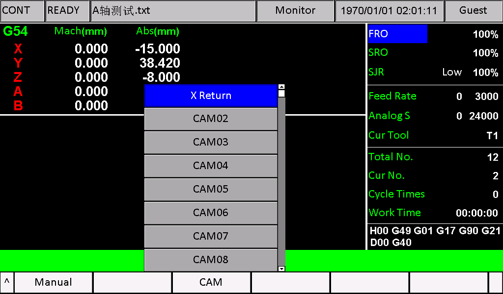
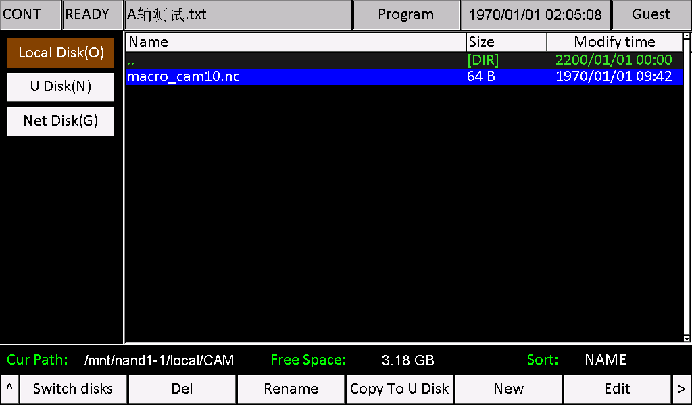
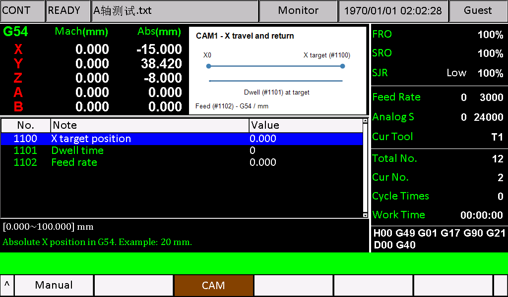
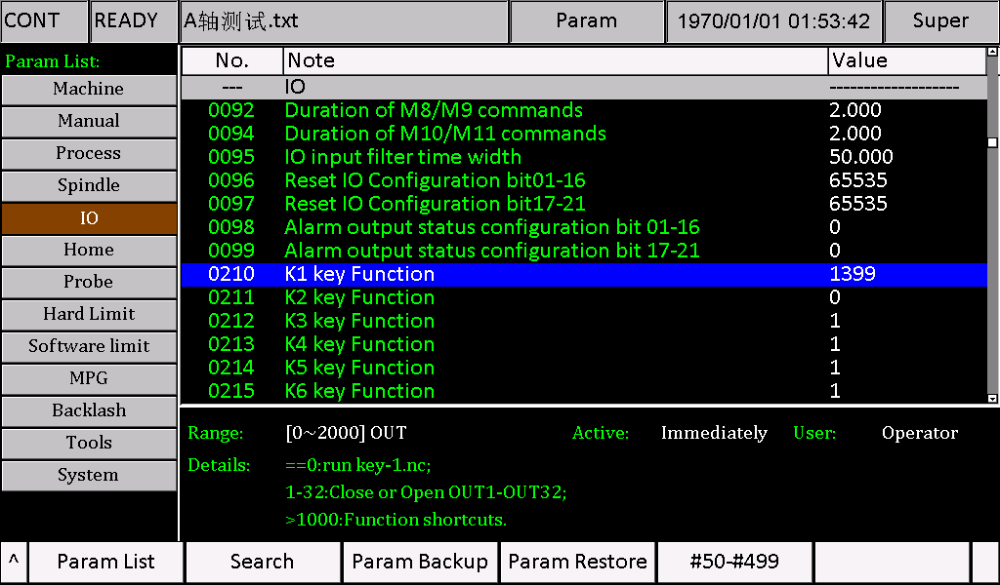
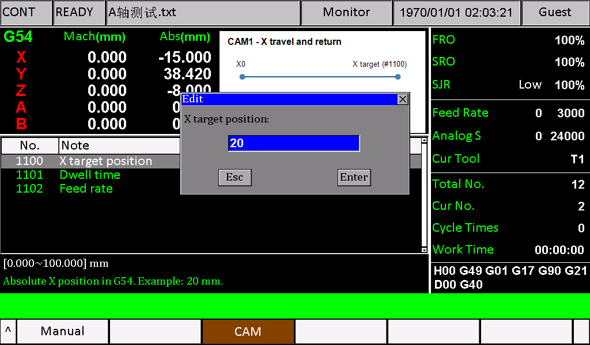
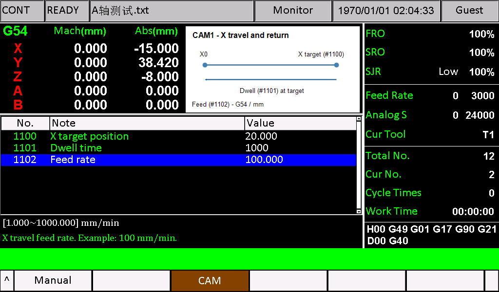
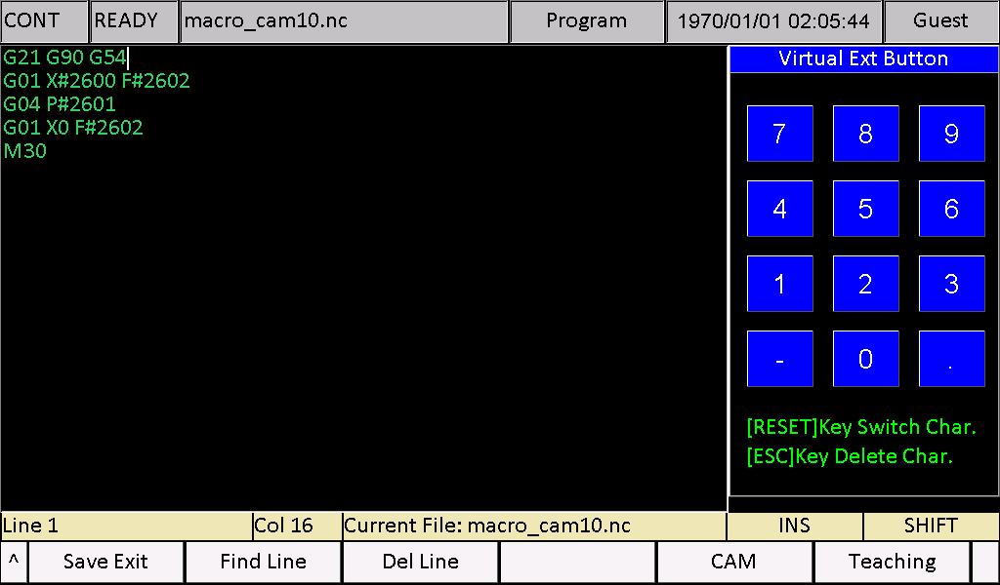

# M350 自定义 CAM 操作说明

[English](README.md) | 简体中文

适用软件版本：2024-03-28-00（含）及之后版本。适用硬件：M350 V1、V2。

自定义 CAM 用于把常用加工程序与参数输入页面关联起来。操作人员选择 CAM 项目、输入参数后，控制器执行该项目对应的 NC 文件。加工动作由 NC 文件定义，参数页面本身不会自动生成刀路。

如果设备已经配置好 CAM，直接按第 6.2 节操作。首次定制需要在电脑上准备文件，再安装到控制器；下面以 CAM1 为例。

## 适用版本与配置文件来源

本说明适用于 **2024-03-28-00（含）及之后版本**，硬件为 M350 V1、V2。2024-03-28-00 开始采用 macro 前缀自动启用宏解析，以及 macro_cam编号.nc 的 CAM 入口命名规则。

**必须从用户实际使用的软件版本升级包中取得完整参数文件和字符串配置文件，在这些原文件中修改对应的 CAM 条目。不能直接安装配套示例的 eng、msg1。** 配套完整文件来自 **2026-10-23-05（2026 年 10 月 23 日）**，仅作参考，不能替换其他版本或已有定制的配置文件。修改时应合并保留设备原有定制内容。

操作顺序：确认实际版本和硬件 → 取得同版本升级包 → 根据 240 号参数选择参数及字符串资源 → 复制原文件到工作目录 → 修改 CAM 参数定义和菜单条目 → 安装修改后的同版本资源及图片 → 单独复制 NC 程序到 local/CAM。下方 U 盘目录表示修改后文件的目标位置，不代表应直接复制示例配置文件。

提供的 2026-10-23-05 下载链接是示例基础版本，不是使用本说明的最低版本要求。240=3（其他语言/UTF-8）从 **2024-12-12-00** 才增加，较早版本请使用实际具备的语言选项。示例程序和截图采用 2026-10-23-05，其他版本运行前请核对对应的指令用法。

## 先看这里：下载与安装顺序

控制器升级包下载：[M350 2026-10-23-05 发布页面](https://github.com/foinnc/M350/releases/tag/2026-10-23-05)。请按实际硬件选择：**V1 使用 V1 升级包，V2 使用 V2 升级包**。GitHub 自动提供的 Source code 源码压缩包不是控制器升级包。

首次配置按以下顺序操作：**备份 → 必要时升级控制器 → 安装 CAM 示例资源 → 复制 NC 程序 → 配置 K1 → 输入参数 → 核对运动路径 → 启动**。已运行适用版本的设备无需仅为本说明升级至示例版本。控制器基础升级按本机原有升级流程操作，下面单独说明 CAM 文件的放置方法。

将本说明书及其 `CAM1-Example` 文件夹一起下载，在电脑上解压后使用。不要把 GitHub 网页另存为 `eng` 或 `msg1`。配套这两个文件仅作参考，不得直接安装；应修改用户所用版本升级包的原文件并保留已有定制。先完成基础版本升级，再安装示例资源，避免示例被基础升级包覆盖。

本配套示例使用**英文界面**：`eng` 定义参数，`msg1` 定义菜单文字。其他语言使用各自对应的资源文件。定制其他语言前，应先确认该版本实际使用的参数资源和菜单资源文件名，不能统一按 `eng`、`msg1` 修改，也不能只重命名英文文件作为翻译。

### 240 号参数：选择对应的语言资源

**240 号参数 Language（语言）**决定控制器加载哪一组资源：

| 240 号参数 | 界面语言 | 参数定义文件 | 菜单及提示文字文件 |
| --- | --- | --- | --- |
| 0 | 英文 | `eng` | `msg1` |
| 1 | 中文 | `chs` | `msg` |
| 2 | 俄文 | `rus` | `msg2` |
| 3 | 其他语言（UTF-8） | `cfg_utf8` | `msg_utf8` |

按当前语言，在第三列文件中修改 CAM 参数定义，在第四列文件中修改 CAM 菜单文字。第一个 CAM 项目的菜单条目仍为 #647，后续按原编号依次对应。保留原文件编码及换行；“其他语言”使用 UTF-8 资源。V1 将这两个资源放在 U 盘 `install/`，V2 放在 `psys/`。修改 240 号参数或安装资源后重启，再分别核对菜单名称和参数页面。

**配套示例仅提供英文资源，要求 240 = 0。** 如需中文、俄文或其他语言，应在对应的现有完整文件中加入或修改本例参数及菜单文字；只修改 `eng`、`msg1` 不会更新其他语言下的 CAM 界面。“其他语言”选项不会自动翻译，实际显示内容由 `cfg_utf8`、`msg_utf8` 决定。

### U 盘文件怎么放

只使用与本机硬件对应的资源目录。以下仅展示 CAM 示例文件，不是完整控制器升级包的目录清单。

**V1 的 U 盘根目录：**

```text
install/
├── eng
├── msg1
└── CAM/
    └── cam10.bmp
CAM/
└── macro_cam10.nc
```

**V2 的 U 盘根目录：**

```text
psys/
├── eng
├── msg1
└── CAM/
    └── cam10.bmp
CAM/
└── macro_cam10.nc
```

根目录的 `CAM` 用于向本地磁盘复制 NC 程序；`install/CAM` 或 `psys/CAM` 用于安装示意图。不要将整个 `CAM1-Example` 文件夹直接放入升级目录。

### 启动前先核对安装结果

| 在哪里检查 | 正确结果 |
| --- | --- |
| 210 号参数 | `1399` |
| 按面板 K1 打开的菜单 | 第一项为 `X Return` |
| 进入 X Return 后 | 图片正向显示，列出 1100、1101、1102 三个参数 |
| 本地磁盘 → CAM 文件夹 | 存在 `macro_cam10.nc` |
| 三个参数分别确认后 | `20.000`、`1000`、`100.000` |

任何一项不符合时，先按常见问题检查，再启动。只看到菜单名或示意图，不能说明 NC 程序已经放好。

## 配套示例与首次配置顺序

本说明配套 [CAM1 示例](CAM1-Example/) 文件夹，图片和 NC 用于演示，完整 eng 和 msg1 仅供参考，不可直接安装：

| 文件 | 内容 | 放置方式 |
| --- | --- | --- |
| [macro_cam10.nc](CAM1-Example/macro_cam10.nc) | X 轴到目标位置、停留、返回 X0 | 控制器 `local/CAM/` |
| [cam10.bmp](CAM1-Example/cam10.bmp) | X 轴往返示意图 | V1 U 盘 `install/CAM/`；V2 U 盘 `psys/CAM/` |
| [msg1](CAM1-Example/msg1) | 2026-10-23-05 英文菜单参考文件，第一个 CAM 项目命名为 `X Return`（X 轴往返） | 修改本机版本同名文件后安装：V1 `install/`；V2 `psys/` |
| [eng](CAM1-Example/eng) | 2026-10-23-05 完整英文参数资源，已配置 CAM1 的三个参数 | 修改本机版本同名文件后安装：V1 `install/`；V2 `psys/` |

1. 确认设备软件版本为 `2024-03-28-00` 或之后，并确认硬件为 V1 还是 V2。
2. 备份设备原有 `msg1`、`eng` 和已有 CAM1 文件。示例会替换 CAM1 参数定义与程序；设备已有定制内容时，先比较差异，不要直接覆盖。
3. 将按示例修改后的本机版本参数及字符串文件和 `cam10.bmp` 放入本机对应的 U 盘目录，通过系统更新功能安装，完成后重启。本示例不包含固件程序，不要为安装示例混入其他版本的 out 文件。
4. 将 240 号参数设为 `0`（英文），并重启生效。配套文件只修改 `eng`，中文或其他语言不会显示本示例的英文参数定义。
5. 将配套 `macro_cam10.nc` 放入 U 盘的 `CAM` 文件夹。如果本地磁盘 `local/` 下没有 `CAM` 文件夹，直接把 U 盘中的整个 `CAM` 文件夹复制到本地磁盘；如果已有该文件夹，只复制 NC 文件到其中，保留其他项目文件。
6. 将 210 号参数设为 `1399`，在停止加工时按 K1，选择第一个 CAM 项目 `X Return`。
7. 核对图片及三个参数，按第 7 节输入示例值并验证动作。

配置成功后，CAM1 应显示 X 往返示意图，以及 `X target position`、`Dwell time`、`Feed rate` 三个参数。选择其他 CAM 项目不会调用这套 CAM1 文件。

## 1 使用前准备

定制一个 CAM 项目，需要准备三类内容：

| 内容 | 用途 | CAM1 示例 |
| --- | --- | --- |
| BMP 图片 | 展示加工示意图和参数位置 | `cam10.bmp` |
| 语言参数定义 | 定义参数名称、分组、输入范围和提示文字 | 参数 1100，分组 `-m30` |
| NC 程序 | 读取参数并执行加工动作 | `macro_cam10.nc` |

修改前备份设备现有语言文件、CAM 程序、图片和参数。由熟悉机床坐标、刀具及程序的人员完成定制和首次验证。

## 2 菜单与文件对应关系

菜单中的第一个 CAM 项目使用文件编号 10，后续依次递增。菜单名称可能随语言资源改变，应按项目顺序确认对应关系。

| 菜单项目 | 图片文件 | NC 程序文件 | 参数分组 |
| --- | --- | --- | --- |
| CAM1 | `cam10.bmp` | `macro_cam10.nc` | `-m30` |
| CAM2 | `cam11.bmp` | `macro_cam11.nc` | `-m31` |
| CAM3 | `cam12.bmp` | `macro_cam12.nc` | `-m32` |
| CAM4 | `cam13.bmp` | `macro_cam13.nc` | `-m33` |
| CAM5 | `cam14.bmp` | `macro_cam14.nc` | `-m34` |
| CAM6 | `cam15.bmp` | `macro_cam15.nc` | `-m35` |
| CAM7 | `cam16.bmp` | `macro_cam16.nc` | `-m36` |
| CAM8 | `cam17.bmp` | `macro_cam17.nc` | `-m37` |
| CAM9 | `cam18.bmp` | `macro_cam18.nc` | `-m38` |
| CAM10 | `cam19.bmp` | `macro_cam19.nc` | `-m39` |

当前程序生成 30 个菜单选项。按第 n 项计算，图片和程序编号为 n+9，参数分组为 n+29；第 30 项对应 `cam39.bmp`、`macro_cam39.nc`、`-m59`。菜单中有选项不代表对应图片、参数和加工程序已经配置完成。



### 自定义菜单名称

英文界面的 CAM 菜单文字在 `msg1` 中定义，其他语言应修改已确认的对应菜单资源：`#647` 对应 CAM1，`#648` 对应 CAM2，依次到 `#676` 对应 CAM30。配套完整 `msg1` 只把 `#647 "CAM01"` 改为 `#647 "X Return"`，表示本例的 X 轴往返。

修改名称不会改变项目顺序、文件编号或参数分组；`X Return` 仍使用 `cam10.bmp`、`macro_cam10.nc` 和 `-m30`。在设备现有完整 `msg1` 中修改对应条目，保留编码及换行，不要用单行片段覆盖整个文件。V1 安装到 U 盘 `install/msg1`，V2 安装到 `psys/msg1`，通过系统更新安装并重启后核对菜单。

## 3 制作示意图片

使用以下格式保存图片：

- 尺寸：360 × 180 像素。
- 位深：24 位。
- 格式：普通未压缩 BMP，使用标准 54 字节文件头布局。
- 名称：按菜单编号命名，例如 `cam10.bmp`，使用小写文件名。
- 方向：绘制好正常方向的图片后，先上下翻转（垂直镜像），再保存 BMP。不要左右镜像。

在图片上标明尺寸符号，并使其与参数名称一致。本例图片中的 X target、Dwell、Feed 分别对应目标位置、停留时间和进给速度。

配套 `cam10.bmp` 已完成上下翻转，可直接安装，不要再次翻转。在电脑上预览时文字上下颠倒属于正常现象，控制器显示后应为正向。自行制作新图时，请先完成正常方向的图文排版，再将整张图片上下翻转后保存。

图片通过升级资源目录安装：

| 硬件 | U 盘资源目录 |
| --- | --- |
| V1 | `install/CAM/` |
| V2 | `psys/CAM/` |

通过系统更新功能安装图片后，选择对应的 CAM 项目即可显示示意图。

这里的 U 盘 `CAM` 文件夹用于安装图片；下一节设备程序目录中的 `CAM` 文件夹用于存放 NC 程序。两者用途和位置不同。

例如，V1 的 U 盘放置 `install/CAM/cam10.bmp`，V2 放置 `psys/CAM/cam10.bmp`。只使用与本机硬件对应的目录，不混用两代升级文件。

## 4 准备加工程序

### 4.1 设备中的存放位置

打开控制器的本地磁盘 `local/`，检查是否已有 `CAM` 文件夹。V1、V2 的操作相同。

- 如果没有：在 U 盘根目录创建名为 `CAM` 的文件夹，将 `macro_cam10.nc` 放入其中，再通过控制器文件管理功能，把整个 `CAM` 文件夹复制到本地磁盘 `local/`。
- 如果已有：将 `macro_cam10.nc` 复制到现有的 `CAM` 文件夹中，保留其他项目文件。若存在同名文件，先备份再覆盖。

例如，CAM1 的文件位置为：`local/CAM/macro_cam10.nc`。

其他项目只需按对应表修改文件编号。文件名和目录名区分大小写，目录必须使用大写 `CAM`。

图片安装步骤不会自动把 NC 程序复制到本地磁盘的 `CAM` 文件夹，需要单独放入。

旧示例中的 `cam10.nc` 不能直接作为当前 CAM1 的入口文件使用，应检查程序内容后按新规则命名和放置。

以小写 `macro_` 开头的文件（如 `macro_cam10.nc`），启动时会自动启用本次程序的宏解析方式，无需手动打开 76 号参数“宏扫描开关”。这不会修改或保存 76 号参数的设置；其他不以 `macro` 开头的文件按该参数设置执行。



### 4.2 参数与宏地址

自定义参数使用 1100～1499 号参数，相应宏地址为 `#2600～#2999`。

计算关系：**宏地址 = 参数号 + 1500**。

| 参数号 | 程序中的宏变量 |
| --- | --- |
| 1100 | `#2600` |
| 1101 | `#2601` |
| 1102 | `#2602` |
| 1103 | `#2603` |
| 1499 | `#2999` |

宏地址由参数号决定，与 CAM 菜单序号无关。例如，CAM2 使用参数 1120 时，程序读取 `#2620`。为每个参数保留明确用途，避免覆盖其他 CAM 项目已经使用的定义。

## 5 定义参数页面

### 5.1 修改语言资源

在设备实际使用的语言资源中增加或修改参数定义。升级资源中常见文件包括 `chs`、`eng`、`rus` 和 `cfg_utf8`；需维护实际使用的相应版本。

V1 的语言文件位于升级包 `install/`，V2 位于 `psys/`。在现有完整语言文件内修改，保留原编码、换行和文件结构。不要用仅含 CAM 参数的片段覆盖完整语言文件，也不要重复定义已经存在的参数号。

### 5.2 配套 CAM1 参数

以下是配套 eng 中的参考定义，请修改本机版本升级包内的对应参数条目，不要安装整个示例 eng 或重复追加同号参数。三个参数均属于 `-m30` 分组，用于三轴及以上设备。

| 参数号 | 英文名称 | 含义 | 宏地址 | 首次输入值 |
| --- | --- | --- | --- | --- |
| 1100 | X target position | G54 下的 X 绝对目标位置，mm | `#2600` | 20 |
| 1101 | Dwell time | 到达目标后的停留时间，ms | `#2601` | 1000 |
| 1102 | Feed rate | X 轴往返进给速度，mm/min | `#2602` | 100 |



文件内容：

```text
#1100 -p0 -a3 -t1 -s1"X target position" -s2"mm" -m30 -min=0.000 -max=100.000
-s3"Absolute X position in G54. Example: 20 mm."
#1101 -p0 -a3 -t0 -s1"Dwell time" -s2"ms" -m30 -min=1 -max=60000
-s3"Pause at target. Example: 1000 ms = 1 second."
#1102 -p0 -a3 -t1 -s1"Feed rate" -s2"mm/min" -m30 -min=1.000 -max=1000.000
-s3"X travel feed rate. Example: 100 mm/min."
```

`-s1` 为名称，`-s2` 为单位，`-s3` 为说明，`-m30` 将参数归入 CAM1。`-t1` 为小数参数，`-t0` 为整数参数，`-min` 和 `-max` 为输入范围。`-a3` 带有轴数条件，轴数不足时参数可能不显示。

配套范围只用于演示，不代表机床一定允许这些位置和速度。安装语言文件不会自动把参数值设为表中的首次输入值，必须在页面中逐项输入并确认。

后续定制时修改原有参数条目，不要重复追加同号参数。若参数已被其他功能使用，需要重新分配参数号，并同时修改 NC 文件中的宏地址。

## 6 配置入口并使用

### 6.1 将 K1 设置为 CAM 入口

1. 记录 210 号参数的原值及 K1 原有用途。
2. 将 210 号参数“外部 K1 功能定义”设为 `1399`，确认保存。
3. 在设备停止加工时按 K1，打开自定义 CAM 菜单。

该设置会改变 K1 原来的功能。设备面板没有可用 K1 时，应由调试人员配置其他适用入口。



### 6.2 日常操作

1. 确认对应图片、语言参数和 NC 文件已安装。
2. 确认回零状态、工件坐标系、刀具和工件装夹符合该程序要求。
3. 按面板 K1，选择已配置的 CAM 项目，按确认进入参数页面。
4. 核对示意图、参数名称和单位；逐项打开编辑框、输入数值并按 Enter 确认，返回列表核对实际显示值。Esc 用于取消当前编辑。
5. 按启动键执行该项目的 NC 文件。
6. 加工结束后检查设备状态和工件结果。

启动时必须处于选定项目的 CAM 参数页面。不要假设退出 CAM 页面后按启动仍会执行同一个项目。

## 7 运行配套 CAM1 示例

### 7.1 输入参数并启动

1. 将 NC、图片及修改后的本机版本参数和字符串配置文件按前文放好，切换至英文界面。
2. 按 K1，选择第一个 CAM 项目 `X Return`，确认显示配套图片和第 5.2 节三个参数。
3. 逐项输入并按 Enter 确认：1100 `X target position = 20 mm`、1101 `Dwell time = 1000 ms`、1102 `Feed rate = 100 mm/min`。返回列表后应分别显示 `20.000`、`1000`、`100.000`，特别注意进给速度不是 `10.000`。编辑框仍打开时，数值尚未确认。
4. 确认 G54 工件坐标系，检查当前位置到 X20、再到 X0 的路径无干涉，保留足够的刀具与工件间距。
5. 保持在该 CAM 参数页面，按启动键。
6. 预期 X 轴以 100 mm/min 移动到 G54 坐标 X20，停留约 1 秒，再以相同进给速度返回 X0，执行 M30 结束。

本例仅移动 X 轴，不发出 Y、Z 移动或主轴启动指令。首次运行前仍需核对机床配置中的启动、结束及 M 代码附加动作。

运行时使用机床面板的启动、暂停控制。K1 用于打开项目菜单，不是循环启动键。如果曾通过文件管理的 Edit 查看 NC 程序，查看结束后应退出编辑器，重新按 **K1 → X Return** 进入 CAM 参数页再启动；下方程序编辑截图只用于说明文件内容，不是 CAM 启动页面。首次运行前确认暂停键位置；运动异常时，按机床规定的停止或急停流程处理。

输入目标位置时，在编辑框中输入 20，再按 Enter 确认。



三个参数必须分别确认。下面是本例设置完成的页面：



### 7.2 配套 NC 文件内容

```gcode
G21 G90 G54
G01 X#2600 F#2602
G04 P#2601
G01 X0 F#2602
M30
```



第一行指定公制、绝对编程和 G54；第二行读取目标位置和进给速度；第三行读取停留时间，P 值单位为毫秒；第四行以相同进给返回 X0；最后结束程序。

当前版本延时使用 `G04 P...`，不要用 `G04 X1` 代替。程序中的 X0 是工件坐标零点，不是“停止移动”。

### 7.3 确认参数生效

第一次运行结束后，在路径允许的前提下，将 `X target position` 改为 `10`，其他两项保持不变。再次启动，目标应变为 X10，停留约 1 秒后返回 X0。无需更改 NC 文件。

若要观察更明显的停留，可将 `Dwell time` 改为 `2000`，停留应约为 2 秒。参数不会由示例自动初始化，每次运行前检查三个实际输入值。

这是一套演示参数调用的往返程序，没有进退刀、主轴控制或完整加工循环。实际加工需要按工艺重新编写 NC 程序。

## 8 常见问题

| 现象 | 检查内容 |
| --- | --- |
| 按 K1 没有打开 CAM 菜单 | 210 号参数是否为 1399；设备是否正在加工；K1 输入是否正常 |
| 菜单存在，但参数为空 | 当前语言文件是否包含对应分组；参数是否受轴数条件限制；资源是否已重新加载 |
| 图片不显示或显示异常 | 文件名与菜单编号；设备图片位置；360×180、24 位、标准未压缩 BMP 格式；图片是否已上下翻转 |
| 启动时找不到程序 | 是否使用 `macro_cam10.nc` 等名称；是否位于本地磁盘 `local/` 下的 `CAM` 文件夹；大小写是否正确 |
| 程序读到的值与预期不同 | 宏地址是否等于参数号加 1500；是否与其他项目共用或覆盖了参数 |
| 旧例程不能直接启动 | 先检查旧命名和路径，再检查程序单位、参数含义及机床适用条件 |

## 9 文档更新

后续文档将发布在 [https://docs.foinnccnc.com/](https://docs.foinnccnc.com/)，敬请期待。
