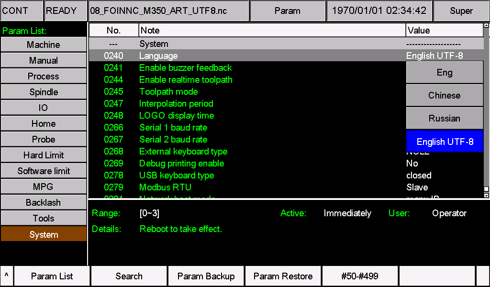
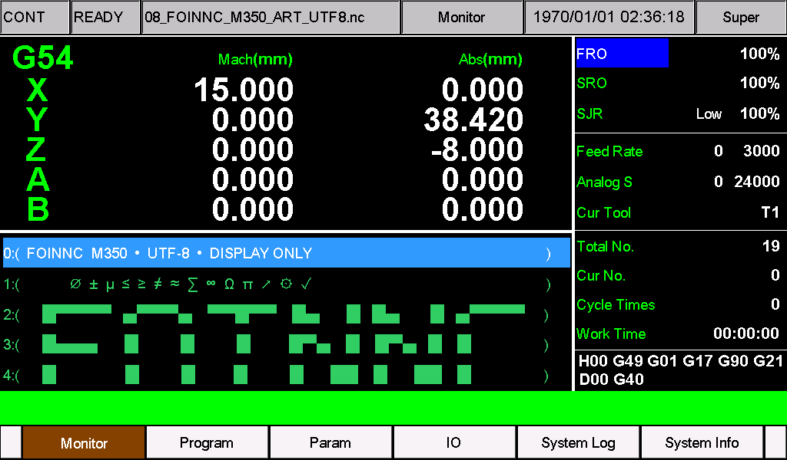

# M350 English UTF-8 language pack

For M350 V1 and V2 running **2026-11-05-02**. This resource-only pack provides an English interface in **Pr240 = 3 (Other)**, using the Unicode font with the engineering symbols supported by that software. It contains no firmware or machine settings.

**Note: filename display.** To maintain compatibility with released system versions, when using an additional language (**Pr240 = 3, UTF-8**), English characters in filenames display normally, while non-English characters may display incorrectly. Use English letters, digits and underscores in filenames, for example `PART_001.nc`, and keep the file extension. Check interface and parameter text after installation; see this pack's known limitations.

## Pr240: standard English or English UTF-8

| Pr240 | Mode | Resources and NC text |
| --- | --- | --- |
| **0** | **Standard English (Eng)** | Loads `eng` and `msg1` with the original legacy encoding and font. This is not the UTF-8 mode. |
| **3** | **English UTF-8 (with this pack installed)** | Loads `cfg_utf8` and `msg_utf8` with the Unicode font. Use UTF-8 NC text to display supported engineering symbols. |

**For English UTF-8, install both files, set Pr240 = 3, save, and restart.** Value 3 uses the existing Other-language slot; its displayed name depends on the installed pack. NC encoding is not detected automatically. Keep original GBK files and convert a copy when needed.

## Installation

1. Stop machining. Verify the hardware generation and software version. Back up the full system disk, machine settings, and existing language resources.
2. Check any customized parameters, CAM menus, macros and alarms before replacing resources. This pack uses the current Chinese resource's four-tool CAM parameter layout; see the compatibility note below.
3. Extract `M350-English.zip`. For **V1**, copy the `install` folder inside `V1` to the USB drive root. For **V2**, copy the `psys` folder inside `V2` to the USB drive root. Copy only the folder for your hardware.
4. Install using the machine's normal resource update procedure. Install **both** `cfg_utf8` and `msg_utf8` from this pack together; keep their filenames unchanged, without `.txt`.
5. Set **Pr240 = 3**, save, and restart. The custom-language option then reads **English UTF-8**. Remove the update USB drive after installation.
6. Check the parameter names, options, menus, alarms and an existing UTF-8 symbol sample while the machine is idle. Verify machine settings and customized functions before machining.

| Hardware | Files |
| --- | --- |
| V1 | `V1/install/cfg_utf8`, `V1/install/msg_utf8` |
| V2 | `V2/psys/cfg_utf8`, `V2/psys/msg_utf8` |

The V1 and V2 resource contents are identical. Encoding is UTF-8 without BOM, with CRLF line endings. English labels use ASCII characters, which are also valid UTF-8. The files contain 1,660 parameter text fields and 879 menu/message text fields.

## V2 screen examples

*V2 capture taken on 9 November 2026. English UTF-8 corresponds to Pr240 = 3. Save and restart even if the general status says "Active: Immediately"; the detail below says "Reboot to take effect."*

*V2 main screen showing English labels and the display-only file `08_FOINNC_M350_ART_UTF8.nc`. The controller clock was not set to the capture date.*

## English mode and NC text

- **Pr240 = 0** continues to load `eng` and `msg1` with the original legacy encoding and font. Installing this pack does not modify that mode.
- **Pr240 = 3** loads this pack's `cfg_utf8` and `msg_utf8` and uses the Unicode font. English font size, spacing and appearance may differ from mode 0.
- This replaces the existing Other-language slot; it does not add a fifth language or retain another custom language in that slot.
- Automatic NC file encoding detection is **not** added. Use UTF-8 NC text with mode 3. Do not assume existing GBK comments or filenames will display correctly in this mode; preserve originals and convert a copy when necessary. Do not change NC commands, numerical values or units during conversion.
- Supported symbols depend on the installed font. This does not add emoji or complex-script shaping.

## Parameter corrections and CAM compatibility

The English parameter resource corrects damaged titles/options/help for Pr71, 134, 242, 249, 255, 257, 258, 259, 260 and 270. Pr257 is the toolpath board thickness in statue mode.

Pr969 was not just a damaged title: the older English file used a different CAM layout. This pack aligns **Pr950-972** with the current Chinese four-tool definitions, including parameter types, menu groups, units and ranges:

| Parameter | Definition |
| --- | --- |
| 950-953 | T1-T4 process-file selection |
| 954 | Safety height Z |
| 955-956 | Starting point Y/Z |
| 957-962 | X positions 1-6 |
| 965 | Tool processing order |
| 966 | Pause between tool changes |
| 967-970 | T1-T4 spindle speeds (Pr969 = T3, rpm) |
| 971 | NC file index number |
| 972 | Custom G-code number (100-200) |

**This pack does not migrate stored parameter values or CAM templates.** A machine using the older two-tool layout must have its saved values, menus and macros reviewed and adapted before installation or switching languages. Do not reuse an old Pr969 custom-G value as a T3 spindle setting. Merge machine-specific resource changes rather than overwriting them. Use short ASCII CAM filenames of at most 19 bytes.
