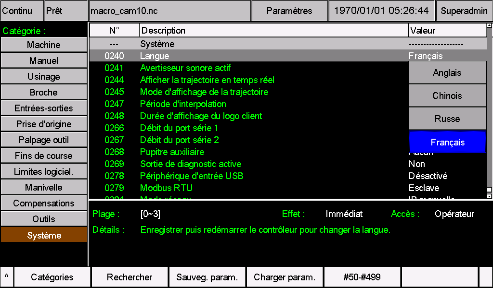
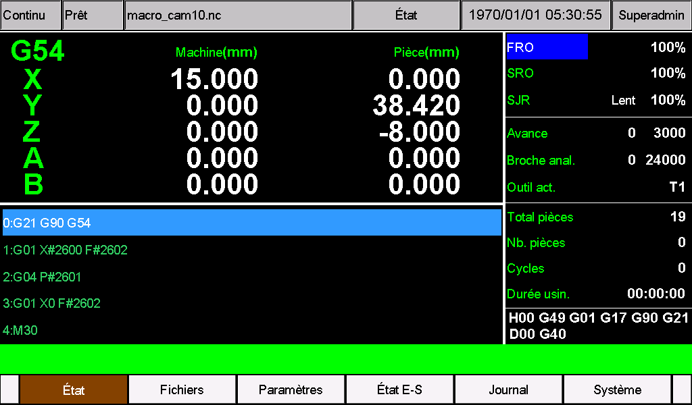

# Pack de langue française M350

Ce pack traduit les paramètres, menus, boutons, états, messages et alarmes du M350 en **français (France)**. Les libellés utilisent le vocabulaire de l'usinage à commande numérique. Des abréviations sont utilisées lorsque la place à l'écran est limitée.

**Matériel : M350 V1 ou V2. Version logicielle requise : 2026-11-05-02.** Installer les deux fichiers ensemble. Ce pack ne contient pas le logiciel du contrôleur.

*Guide mis à jour le 5 novembre 2026.*

Les captures de ce guide présentent la sélection du français et l'écran principal sur un M350 V2 exécutant la version 2026-11-05-02.

**Attention : affichage des noms de fichiers.** Pour maintenir la compatibilité avec les versions du système déjà publiées, lors de l’utilisation d’une langue supplémentaire (**Pr240 = 3, UTF-8**), les caractères anglais des noms de fichiers s’affichent normalement, tandis que les caractères non anglais peuvent s’afficher incorrectement. Utilisez des lettres anglaises sans accent, des chiffres et le trait de soulignement, par exemple `PART_001.nc`, et conservez l’extension. Vérifiez les textes de l’interface et des paramètres après l’installation ; consultez les limites connues de ce paquet.

## Installation rapide

1. Identifier le matériel V1 ou V2 et vérifier la version logicielle dans les informations système.
2. Sauvegarder les paramètres et les deux fichiers de langue actuellement installés. Préserver les adaptations propres à la machine, notamment les menus CAM et les alarmes.
3. Après extraction de l'archive, copier **le dossier `install` situé dans `V1`**, ou **le dossier `psys` situé dans `V2`**, directement à la racine de la clé USB.
4. Installer les ressources avec la procédure de mise à jour habituelle de la machine.
5. Régler **le paramètre 240 sur 3 — Français**, enregistrer, puis redémarrer le contrôleur.
6. Vérifier les textes et les réglages conservés, puis retirer la clé USB de mise à jour.

## Identifier V1 et V2

Observer le premier écran à la mise sous tension :

- **V2 :** fond noir avec les inscriptions blanches `V2.0` et `System Loading ...`, comme dans l'illustration ci-dessous.
- **V1 :** écran de démarrage différent de celui de la V2.


*Illustration destinée à identifier le matériel. Il ne s'agit pas d'une capture d'un M350 utilisant le pack français. La version logicielle se vérifie séparément dans les informations système.*

## Contenu du pack

| Fichier | Contenu | V1 | V2 |
| --- | --- | --- | --- |
| `cfg_utf8` | Noms, options, unités et aides des paramètres | [install/cfg_utf8](V1/install/cfg_utf8) | [psys/cfg_utf8](V2/psys/cfg_utf8) |
| `msg_utf8` | Menus, boutons, états, messages et alarmes | [install/msg_utf8](V1/install/msg_utf8) | [psys/msg_utf8](V2/psys/msg_utf8) |

Les fichiers sont complets : 1 636 champs de texte dans `cfg_utf8` et 879 dans `msg_utf8`. Les copies V1 et V2 ont un contenu identique ; leur emplacement d'installation diffère.

Conserver les noms en minuscules, **sans extension `.txt`**. L'encodage est **UTF-8 sans BOM**, avec des fins de ligne **CRLF**. Les accents français sont conservés. Copier les fichiers sans les réenregistrer dans un autre encodage.

## Préparation

- Vérifier que le logiciel installé est **2026-11-05-02**. Pour une autre version, demander un pack adapté ; l'acceptation de l'UTF-8 ne suffit pas à établir la compatibilité.
- Arrêter l'usinage et effectuer l'installation lorsque la machine est au repos.
- Sauvegarder les paramètres et les fichiers de langue existants ; noter la valeur actuelle du paramètre 240.
- Si la machine possède des menus CAM, des noms de paramètres, des alarmes ou d'autres textes personnalisés, les intégrer au pack avant installation. Leur remplacement par les fichiers standard peut supprimer ces adaptations.

Le pack remplace la langue personnalisée déjà associée à la valeur **3** du paramètre 240. Il n'ajoute pas une cinquième langue et ne permet pas de conserver deux langues personnalisées simultanément.

Le changement de langue ne nécessite ni fichier `setting`, ni programme `.out`, ni rétablissement des paramètres d'usine. Si une mise à jour logicielle est nécessaire, l'effectuer d'abord avec le programme destiné au matériel concerné, puis installer le pack correspondant à cette version.

Saisir les valeurs numériques et les commandes NC dans le format attendu par le contrôleur, en conservant le point décimal lorsqu'il est requis. Ne pas remplacer ce point par une virgule pour adapter les valeurs ou les programmes à la langue française.

## Préparer la clé USB

Copier uniquement le dossier d'installation correspondant au matériel. La structure à la racine de la clé doit être exactement la suivante.

**M350 V1 :**

```text
USB/
└─ install/
   ├─ cfg_utf8
   └─ msg_utf8
```

**M350 V2 :**

```text
USB/
└─ psys/
   ├─ cfg_utf8
   └─ msg_utf8
```

Ne pas copier les dossiers extérieurs `French`, `V1` ou `V2` à la racine de la clé. Y placer directement `install` ou `psys`. Copier le fichier ZIP seul ne réalise pas l'installation. Vérifier également l'absence d'anciens programmes ou ressources qui pourraient être installés involontairement.

Si la procédure habituelle de la machine exige un paquet de mise à jour complet, remplacer seulement les deux fichiers de langue dans un paquet destiné **au même matériel et à la version 2026-11-05-02**.

## Installer et sélectionner le français

1. Brancher la clé USB et suivre la procédure de mise à jour des ressources utilisée sur la machine. Attendre la fin de l'opération avant de retirer la clé ou de couper l'alimentation.
2. Redémarrer selon les indications de la machine, puis ouvrir la page des paramètres.
3. Rechercher **0240 — Langue**. Selon la langue encore active, le libellé peut être différent.
4. Choisir **la valeur 3**. Après installation du pack, cette option porte le nom **Français**.
5. Confirmer et enregistrer la modification, puis **redémarrer le contrôleur** pour charger les textes. Même si le champ général `Effet` indique une application immédiate, le changement de langue nécessite ce redémarrage.
6. Vérifier que le paramètre 240 reste à 3 après le redémarrage, puis contrôler l'affichage.



*Capture réalisée le 5 novembre 2026 à 14 h 40 (UTC+8) sur un M350 V2, logiciel 2026-11-05-02. L'option Français correspond à la valeur 3. Même si le champ Effet indique Immédiat, enregistrer puis redémarrer pour changer de langue.*

| Valeur du paramètre 240 | Ressources sélectionnées |
| --- | --- |
| 0 | Anglais |
| 1 | Chinois |
| 2 | Russe |
| **3** | **Français, lorsque ce pack est installé** |

Si la valeur était déjà 3, les nouveaux textes sont chargés au redémarrage après l'installation. Une mise à jour complète ultérieure peut remplacer les fichiers de langue ; les réintégrer alors dans les ressources compatibles avec la nouvelle version.

## Vérifications sur la machine



*Écran principal en français, capturé le 5 novembre 2026 à 14 h 44 (UTC+8) sur un M350 V2, logiciel 2026-11-05-02.*

Les coordonnées, les compteurs et le programme affichés correspondent à l'état de la machine lors de la capture ; ce ne sont pas des valeurs à reproduire. La date de 1970 affichée par le contrôleur n'est pas la date de prise de vue.

Avant de reprendre la production, contrôler :

- Les menus, boutons et états : accents lisibles, sans caractères manquants, coupures ni chevauchements.
- Les paramètres : titres, options, aides et unités corrects ; valeurs et adaptations de la machine conservées.
- Les dialogues : titre, texte et boutons lisibles, notamment les demandes de mot de passe et les messages contenant un nom de fichier ou une valeur numérique.
- Les alarmes et leur historique : numéros et substitutions affichés correctement. Il n'est pas nécessaire de provoquer une alarme ou un mouvement pour vérifier les textes déjà disponibles.
- Les pages CAM : présence des contenus personnalisés et lecture des champs de saisie.
- Le paramètre 240 : valeur 3 conservée après redémarrage.

Les textes intégrés à des images, certains éléments fixes, les noms de fichiers et les commentaires des programmes NC ne sont pas traduits par ces deux ressources. Certains sélecteurs de fichiers utilisent des polices différentes : pour les noms de fichiers, privilégier les lettres sans accent, les chiffres et le trait de soulignement.

En cas de problème, transmettre au fournisseur une photo de l'écran, le numéro du paramètre ou du message, le type V1 ou V2 et la version logicielle.

## Termes et abréviations

| Libellé | Signification |
| --- | --- |
| Avance / F | Vitesse d'avance de l'outil |
| Broche / S | Broche et vitesse de rotation |
| Origine / Prise d'origine | Référencement des axes dans le système machine |
| Zéro pièce | Origine du système de coordonnées de la pièce |
| Machine / Pièce / Coord. | Coordonnées dans le repère machine ou dans le repère pièce |
| Palp. / Palpeur | Palpage ou dispositif de mesure d'outil |
| Correction H / D | Correction de longueur ou de rayon d'outil |
| Jeu à l'inversion | Jeu mécanique compensé au changement de sens |
| Mém. / Mémoriser / Apprentissage | Enregistrement d'une position pour la programmation par apprentissage |
| Qté / Nb. / N° | Quantité / nombre / numéro |
| Enreg. / Sauveg. / Suppr. | Enregistrer / sauvegarder / supprimer |
| Ann. / Rap. / Lent | Annuler / déplacement rapide / déplacement lent |
| E-S / IN / OUT | Entrées-sorties / entrée / sortie |
| Servo imp./dir | Servobroche commandée par impulsions et signal de direction |
| MPG / Maniv. | Manivelle électronique à impulsions |
| FRO / SRO / SJR | Correcteur d'avance / de vitesse de broche / de vitesse manuelle |
| JOG / MDI / RESET | Déplacement manuel / saisie manuelle de commandes / réinitialisation |

Les noms d'axes, codes G et M, unités physiques, chemins de fichiers et identifiants de protocole sont conservés lorsqu'ils font partie du fonctionnement. La traduction ne convertit pas les unités de la machine : les réglages d'unité et les commandes **G20/G21** conservent leurs fonctions.

## Si le français n'apparaît pas

| Symptôme | Vérification |
| --- | --- |
| Aucun changement | Installation terminée, paramètre 240 à 3, enregistrement et redémarrage effectués |
| Seuls les menus changent | Présence de `cfg_utf8` dans le bon dossier |
| Seuls les paramètres changent | Présence de `msg_utf8` dans le bon dossier |
| Accents incorrects | Fichiers toujours en UTF-8 sans BOM, sans conversion d'encodage |
| Texte coupé ou chevauché | Écran concerné et éventuelle modification locale du texte à examiner |
| Traductions perdues après mise à jour | Ressources remplacées par la mise à jour ; intégrer un pack adapté à sa version |

## Revenir à la langue précédente

Si l'interface reste utilisable, choisir au paramètre 240 une langue dont les ressources sont installées, enregistrer et redémarrer. Pour récupérer l'ancienne langue personnalisée de l'option 3, réinstaller les deux fichiers sauvegardés, compatibles avec le logiciel, puis redémarrer.

Si l'affichage empêche l'utilisation normale, suivre la procédure de récupération des ressources de la machine avec les sauvegardes, ou contacter le fournisseur. Ne pas modifier les paramètres de mouvement ni rétablir les paramètres d'usine pour corriger un affichage de langue.

La documentation à venir sera publiée sur [https://docs.foinnccnc.com/](https://docs.foinnccnc.com/). Restez informés.
