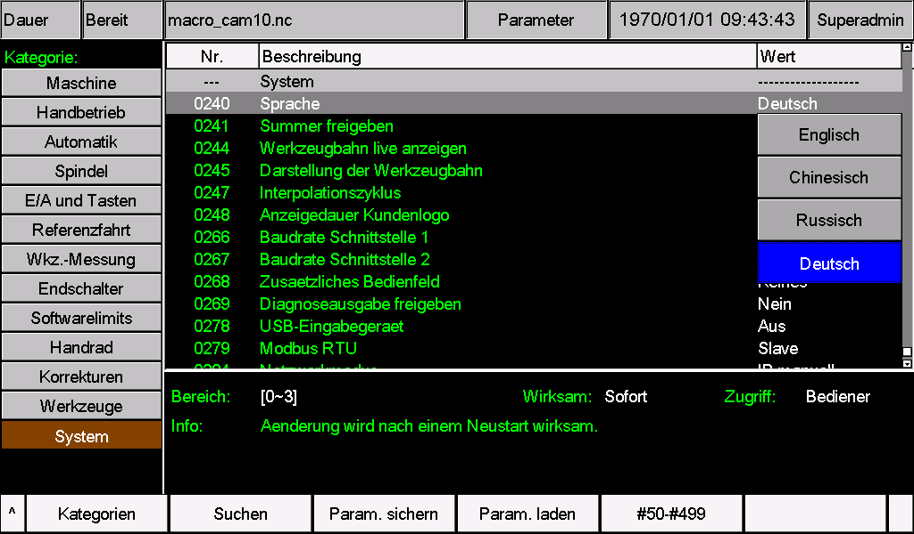
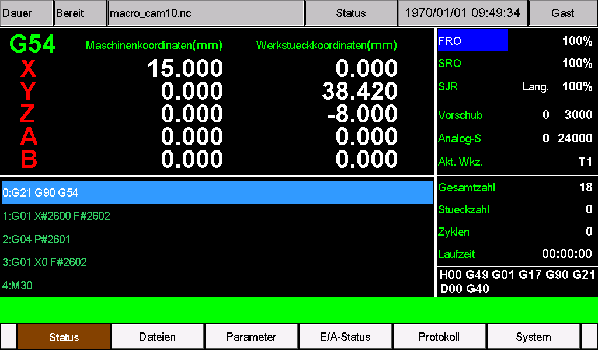

# M350 – Deutsches Sprachpaket

Dieses Paket stellt Parameternamen, Auswahlfelder, Hilfetexte, Menüs und Meldungen des M350 auf Deutsch um. Kurze Bezeichnungen und CNC-übliche Abkürzungen passen die Texte an die begrenzte Bildschirmfläche an.

**Passend für M350 V1 und V2 mit Softwareversion 2026-10-23-05. Installieren Sie immer beide Dateien zusammen.**

## Schnellstart

1. Bestimmen Sie V1 oder V2 anhand des ersten Startbilds und prüfen Sie die Softwareversion in der Systemverwaltung.
2. Sichern Sie die bisherigen Parameter und Sprachdateien. Übernehmen Sie vorhandene maschinenspezifische Anpassungen vor der Installation in dieses Paket.
3. Entpacken Sie das ZIP-Archiv. **Kopieren Sie für V1 den Ordner `install` aus `V1`, für V2 den Ordner `psys` aus `V2` direkt in das Stammverzeichnis des USB-Sticks.**
4. Installieren Sie die Dateien mit dem für Ihre Maschine vorgesehenen Verfahren zur Ressourcenaktualisierung.
5. Stellen Sie **Parameter 240 auf den Wert 3**, speichern Sie die Änderung und starten Sie die Steuerung neu.
6. Prüfen Sie die deutsche Anzeige und die bisherigen Einstellungen. Entfernen Sie anschließend den Update-USB-Stick.

## V1 oder V2 erkennen

Entscheidend ist das Bild, das **unmittelbar nach dem Einschalten zuerst erscheint**:

- **V2:** schwarzer Hintergrund mit weißer Schrift `V2.0` und `System Loading ...`. Verwenden Sie den Ordner `psys`.
- **V1:** ein anderes erstes Startbild. Verwenden Sie den Ordner `install`.


*Die Abbildung veranschaulicht die Hardwareerkennung. Prüfen Sie die Softwareversion zusätzlich in der Systemverwaltung.*

## Dateien und Verwendung

| Datei | Aufgabe | V1 | V2 |
| --- | --- | --- | --- |
| `cfg_utf8` | Parameternamen, Auswahlfelder, Einheiten und Hilfetexte | [Datei für V1](V1/install/cfg_utf8) | [Datei für V2](V2/psys/cfg_utf8) |
| `msg_utf8` | Menüs, Tastenbeschriftungen, Zustände, Meldungen und Alarme | [Datei für V1](V1/install/msg_utf8) | [Datei für V2](V2/psys/msg_utf8) |

Die Dateinamen bleiben unverändert, ohne zusätzliche Endung `.txt`. Beide Dateien sind in **UTF-8 ohne BOM mit CRLF-Zeilenenden** gespeichert. Zum Installieren genügt es, die Dateien unverändert zu kopieren.

**Hinweis zur Anzeige von Dateinamen:** Zur Kompatibilität mit bereits veröffentlichten Systemversionen werden bei einer zusätzlichen Sprache (**Pr240 = 3, UTF-8**) englische Zeichen in Dateinamen normal angezeigt; nichtenglische Zeichen können fehlerhaft dargestellt werden. Verwenden Sie englische Buchstaben ohne Umlaute, Ziffern und Unterstriche, zum Beispiel `PART_001.nc`, und behalten Sie die Dateiendung bei. Prüfen Sie nach der Installation die Texte der Benutzeroberfläche und der Parameter; beachten Sie die bekannten Einschränkungen dieses Pakets.

Das Paket belegt den **benutzerdefinierten Sprachplatz 3**. Wenn dort bisher Portugiesisch, Koreanisch oder eine andere Sprache installiert war, wird sie durch Deutsch ersetzt. Es entsteht kein zusätzlicher Eintrag in der Sprachauswahl.

## Vor der Installation

- Prüfen Sie die Softwareversion **2026-10-23-05**. Bei einer anderen Version müssen die Übersetzungen in deren vollständige Ressourcendateien übernommen werden; wenden Sie sich dazu an Ihren Lieferanten.
- Beenden Sie die Bearbeitung und führen Sie die Installation bei stillstehender Maschine aus.
- Sichern Sie Parameter und Sprachdateien und notieren Sie den bisherigen Wert von Parameter 240.
- Übernehmen Sie maschinenspezifische CAM-Texte, Alarme und Parameteranpassungen in die passenden Dateien, bevor Sie vorhandene Ressourcen ersetzen.
- Für diesen Sprachwechsel sind weder die Datei `setting`, ein `.out`-Programm noch das Zurücksetzen auf Werkseinstellungen erforderlich.

## USB-Stick vorbereiten

Kopieren Sie nur den Ordner für Ihre Hardware. Beim Öffnen des USB-Sticks muss die Struktur so aussehen:

**V1:**

```text
USB/
└─ install/
   ├─ cfg_utf8
   └─ msg_utf8
```

**V2:**

```text
USB/
└─ psys/
   ├─ cfg_utf8
   └─ msg_utf8
```

Die äußeren Ordner `German`, `V1` und `V2` gehören nicht auf den USB-Stick. Auch das ZIP-Archiv allein reicht zur Installation nicht aus. Prüfen Sie, ob noch alte Update-Dateien auf dem Stick liegen.

Falls das Installationsverfahren Ihrer Maschine ein vollständiges Update-Paket erfordert, ersetzen Sie darin nur die beiden Sprachdateien. Verwenden Sie dazu ein Paket **derselben Softwareversion und für dieselbe Hardware**.

## Installieren und Deutsch auswählen

1. Schließen Sie den USB-Stick an und installieren Sie die Ressourcen nach dem Update-Verfahren Ihrer Maschine. Warten Sie bis zum Abschluss; unterbrechen Sie dabei weder die Stromversorgung noch die USB-Verbindung.
2. Starten Sie nach der Geräteanweisung neu und öffnen Sie die Parameterseite. Suchen Sie **Parameter 240**. Seine Bezeichnung hängt von der bisher aktiven Sprache ab, beispielsweise `Language` oder `Idioma`.
3. Wählen Sie **Wert 3**. Der Eintrag kann vor dem Sprachwechsel noch `Other` oder den Namen des vorherigen Sprachpakets anzeigen.
4. Bestätigen und **speichern** Sie die Änderung. **Starten Sie die Steuerung neu**, auch wenn eine allgemeine Anzeige zur Wirksamkeit „sofort“ angibt.
5. Öffnen Sie Parameter **0240 — Sprache** erneut. Der gewählte Eintrag muss **Deutsch** sein, der Wert bleibt **3**.



*Echte Bildschirmaufnahme eines M350 V2 mit installiertem deutschem Sprachpaket. Bei **0240 — Sprache** entspricht **Deutsch** dem Wert **3**. Speichern Sie die Änderung und starten Sie die Steuerung neu. Die allgemeine Anzeige `Wirksam: Sofort` ersetzt diesen Neustart nicht; maßgeblich ist der Hinweis darunter.*

| Wert von Parameter 240 | Sprache |
| --- | --- |
| 0 | Englisch |
| 1 | Chinesisch |
| 2 | Russisch |
| **3** | **Deutsch, wenn dieses Paket installiert ist** |

War der Wert bereits 3, werden die neuen Dateien beim Neustart nach der Installation geladen. Falls auch die Software aktualisiert werden soll, führen Sie zuerst das Software-Update durch und installieren Sie anschließend das dazu passende Sprachpaket. Ein späteres vollständiges Update kann die Sprachdateien erneut ersetzen.

## Anzeige nach der Installation prüfen



*Hauptbild eines M350 V2 nach der Installation des deutschen Sprachpakets.*

Die angezeigten Koordinaten, Parameterwerte, Programminhalte und Geräteangaben dokumentieren den Zustand bei der Aufnahme und sind keine Einstellvorgaben für Ihre Maschine.

Prüfen Sie vor der Wiederaufnahme der Bearbeitung:

- Hauptbild: lesbare Menüs, Zustände und Koordinatenüberschriften ohne abgeschnittene oder überlappende Schrift.
- Parameter 240: `Sprache`, Auswahl `Deutsch`, Wert 3 auch nach dem Neustart.
- Parameterseiten: Namen, Optionen, Hilfetexte und Einheiten; die bisherigen Maschinenwerte müssen erhalten bleiben.
- Meldungsfenster: Titel `Meldung`, lesbarer Text sowie `OK` und `Abbr.` ohne schwarze Flächen. Bestätigen Sie eine Referenzfahrt nur, wenn Sie diese tatsächlich ausführen möchten.
- Alarmhistorie und Dateiverwaltung: richtige Zahlen, Achsen und Dateinamen. Für die Anzeigekontrolle müssen Sie keinen Alarm und keine Bewegung auslösen.
- CAM-Seiten: richtige Texte und Erhalt Ihrer maschinenspezifischen Anpassungen.

Melden Sie Auffälligkeiten mit einem Bildschirmfoto, der betroffenen Parameter- oder Alarmnummer, der Hardwaregeneration und der Softwareversion an Ihren Lieferanten.

## Begriffe und Abkürzungen

| Anzeige | Bedeutung |
| --- | --- |
| Vorschub / F | Vorschubgeschwindigkeit |
| Spindel / S | Arbeitsspindel bzw. Spindeldrehzahl |
| Drehz. | Drehzahl |
| Wkz. | Werkzeug |
| Ref. | Referenzpunkt bzw. Referenzfahrt |
| Werkstueck | Werkstück |
| Korr. | Korrektur, beispielsweise Werkzeuglängen- oder Radiuskorrektur |
| Eilgang | Schnelles Positionieren, beispielsweise mit G00 |
| MPG / Handrad | Elektronisches Handrad zur Achsbewegung |
| JOG / MDI | Manuelles Verfahren / manuelle Befehlseingabe |
| FRO / SRO | Vorschub-Override / Spindeldrehzahl-Override |
| Lang. / Schn. | Langsamer / schneller manueller Vorschub |
| IN / OUT, E/A | Eingangs- und Ausgangssignale |
| LOW / HIGH | Niedriger / hoher logischer Signalpegel |
| Abbr. / OK | Aktion abbrechen / angezeigte Aktion bestätigen |

Inkrementelles manuelles Verfahren und Einzelsatzbetrieb sind unterschiedliche Funktionen. Ebenso unterscheidet sich eine Simulation von der Bearbeitung mit Handradsteuerung.

Achskennzeichen, G- und M-Codes, physikalische Einheiten, Pfade und Kommunikationskennungen behalten ihre erforderliche Schreibweise. Die Sprachwahl stellt die Bearbeitungseinheiten nicht um. Einheiteneinstellungen und **G20/G21** bleiben eigenständige Funktionen. Verwenden Sie bei Zahleneingaben und NC-Programmen weiterhin die von der Steuerung verlangte Schreibweise, insbesondere den **Dezimalpunkt**.

Das Paket erweitert die Bildschirmtastatur nicht. Verwenden Sie für Dateinamen vorzugsweise lateinische Buchstaben ohne Umlaute, Ziffern und Unterstriche, beispielsweise `TEIL_001.nc`. Kommentare in NC-Programmen, Texte in Bildern und einzelne fest vorgegebene Anzeigen werden nicht automatisch übersetzt.

## Probleme beheben und vorherige Sprache wiederherstellen

| Erscheinung | Prüfen |
| --- | --- |
| Keine deutsche Anzeige | Ordner im Stammverzeichnis des USB-Sticks, abgeschlossene Installation, 240 = 3, Speichern und Neustart |
| Nur Menüs sind deutsch | Wurde auch `cfg_utf8` am richtigen Ort installiert? |
| Nur Parameter sind deutsch | Wurde auch `msg_utf8` am richtigen Ort installiert? |
| Kästchen, schwarze Flächen oder verstümmelte Texte | Beide Dateien erneut unverändert aus dem ZIP entpacken; Version, Kodierung und eigene Änderungen prüfen |
| Text ist abgeschnitten oder überlappt | Bildschirm und betroffene Nummer dokumentieren; eigene Textänderungen prüfen |
| Deutsch verschwindet nach einem Software-Update | Die Übersetzungen in die Ressourcendateien der neuen Version übernehmen |

Wenn die Oberfläche bedienbar ist, wählen Sie in Parameter 240 eine bisher funktionierende Sprache mit vorhandenen Dateien, speichern Sie und starten Sie neu. Zum Wiederherstellen der vorherigen benutzerdefinierten Sprache auf Platz 3 installieren Sie die gesicherten Dateien `cfg_utf8` und `msg_utf8` gemeinsam und starten anschließend neu.

Ist eine normale Bedienung nicht möglich, verwenden Sie das Ressourcen-Wiederherstellungsverfahren Ihrer Maschine mit passenden Sicherungsdateien oder wenden Sie sich an Ihren Lieferanten. Ändern Sie wegen eines Anzeigeproblems keine Bewegungsparameter und setzen Sie die Maschine nicht auf Werkseinstellungen zurück.

Weitere Dokumentation wird unter [https://docs.foinnccnc.com/](https://docs.foinnccnc.com/) veröffentlicht. Bleiben Sie gespannt.
