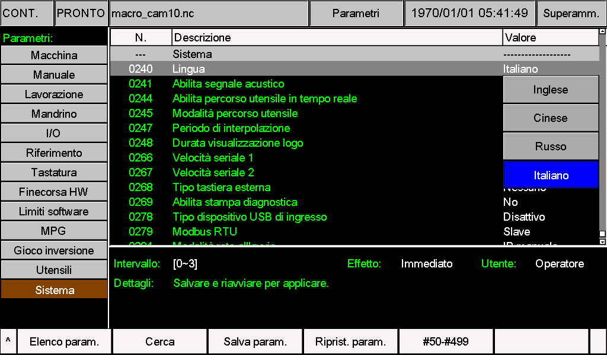
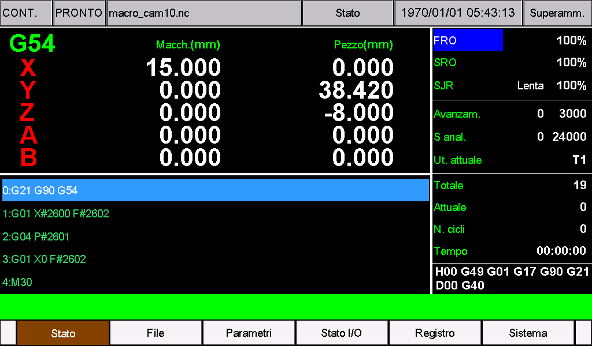

# M350 in italiano

Questo pacchetto traduce in italiano i testi dell'interfaccia, dei parametri e degli allarmi del M350. Usa la terminologia CNC e abbreviazioni adatte alle dimensioni dei comandi sullo schermo.

**Versione software di riferimento: 2026-11-05-02. Risorse per M350 V1 e V2.** Prima dell'installazione verificare che il software del proprio hardware corrisponda a questa versione. Le risorse V1 e V2 contengono gli stessi testi, ma devono essere collocate nelle rispettive cartelle. Il pacchetto non contiene programmi `.out` e non aggiorna il software del controllore.

*Guida aggiornata il 5 novembre 2026.*

Le immagini di questa guida mostrano la selezione dell'italiano e la schermata principale su un M350 V2 con software 2026-11-05-02.

## Contenuto

| File | Contenuto | V1 | V2 |
| --- | --- | --- | --- |
| `cfg_utf8` | Nomi, opzioni, unità e descrizioni dei parametri | [V1/install/cfg_utf8](V1/install/cfg_utf8) | [V2/psys/cfg_utf8](V2/psys/cfg_utf8) |
| `msg_utf8` | Menu, pulsanti, stati, messaggi e allarmi | [V1/install/msg_utf8](V1/install/msg_utf8) | [V2/psys/msg_utf8](V2/psys/msg_utf8) |

I due file sono completi e vanno installati insieme. Usano **UTF-8 senza BOM**, normalizzazione NFC e terminazioni di riga CRLF. Conservare i nomi esatti, in minuscolo e senza aggiungere `.txt`.

Il pacchetto occupa l'opzione **3** del parametro **240**, identificata come **Italiano** dopo l'installazione. Sostituisce la lingua personalizzata già assegnata a questa opzione; non aggiunge una quinta lingua. I valori 0, 1 e 2 restano associati rispettivamente a inglese, cinese e russo.

## Riconoscere l'hardware

All'accensione, il M350 V2 mostra una schermata nera con le scritte bianche **V2.0** e **System Loading ...**, come nell'illustrazione:


L'immagine è un'illustrazione dell'avvio, non una prova dell'interfaccia italiana. La schermata di avvio V1 è diversa. In caso di dubbio, verificare l'hardware con il fornitore prima di scegliere la cartella. La versione del software va controllata separatamente nella pagina delle informazioni di sistema.

## Prima dell'installazione

1. Verificare la versione software **2026-11-05-02** e il tipo di hardware V1 o V2.
2. Arrestare la lavorazione e lasciare la macchina inattiva.
3. Salvare una copia dei parametri e dei due file di lingua attuali. Annotare il valore del parametro 240.
4. Se esistono nomi di parametri, menu CAM, allarmi o altre risorse personalizzate, integrare le traduzioni nei file del cliente prima di installare. Conservare numeri, campi, collegamenti e personalizzazioni.

Per una versione software diversa, usare come base i file completi di quella versione e verificarne la compatibilità; non sostituirli direttamente con questo pacchetto. Per V1 occorre il software corrispondente compilato per V1: un programma V2 non è utilizzabile su V1.

Non aggiungere il file `setting` e non ripristinare i parametri di fabbrica per cambiare lingua. Le unità fisiche, i codici G e M, gli assi, i percorsi e i segnaposto funzionali sono preservati. La traduzione non converte le unità della macchina o del programma: i parametri delle unità e **G20/G21** mantengono le proprie funzioni.

Inserire numeri e comandi NC nel formato richiesto dal controllore, mantenendo il punto decimale dove previsto. Non sostituire il punto con la virgola nei valori o nei programmi per adattarli alla lingua italiana.

## Preparare la chiavetta USB

Aprire la cartella relativa al proprio hardware:

- **V1:** copiare l'intera cartella `install` da `V1` direttamente nella radice della chiavetta.
- **V2:** copiare l'intera cartella `psys` da `V2` direttamente nella radice della chiavetta.

La struttura deve essere la seguente:

**M350 V1**

```text
USB/
└─ install/
   ├─ cfg_utf8
   └─ msg_utf8
```

**M350 V2**

```text
USB/
└─ psys/
   ├─ cfg_utf8
   └─ msg_utf8
```

Non copiare nella radice le cartelle esterne `Italian`, `V1` o `V2`. Copiare soltanto la cartella destinata al proprio hardware e verificare che sulla chiavetta non rimangano vecchi programmi o risorse da installare involontariamente.

Se la procedura abituale richiede un aggiornamento completo, inserire questi due file nel pacchetto completo della stessa versione **2026-11-05-02**, specifico per V1 oppure V2. I file `.out` delle due generazioni non sono intercambiabili.

## Installare e attivare l'italiano

1. Inserire la chiavetta e seguire la procedura di aggiornamento già prevista per il proprio controllore.
2. Attendere il completamento della copia delle risorse e riavviare secondo tale procedura.
3. Aprire la pagina dei parametri e selezionare il **parametro 240 — Lingua**.
4. Impostare il valore **3**. Prima del caricamento dell'italiano può essere indicato come `Other`, come altra lingua personalizzata oppure come `Italiano`.
5. **Confermare, salvare e riavviare il controllore.** Il riavvio è necessario per caricare i nuovi testi, anche se l'indicazione generale di effetto del parametro appare immediata.
6. Controllare le schermate e rimuovere la chiavetta di aggiornamento.



*Immagine acquisita il 5 novembre 2026 alle 14:55 (UTC+8) su un M350 V2 con software 2026-11-05-02. Italiano corrisponde al valore 3. Anche se il campo Effetto indica Immediato, salvare e riavviare per cambiare lingua.*

| Valore del parametro 240 | Lingua selezionata |
| --- | --- |
| 0 | Inglese |
| 1 | Cinese |
| 2 | Russo |
| **3** | **Italiano, con questo pacchetto installato** |

Se il parametro 240 era già impostato su 3, l'italiano viene caricato al riavvio successivo all'installazione. Non selezionare 0, 1 o 2 per attivare questo pacchetto.

Un aggiornamento completo successivo può sovrascrivere le risorse tradotte. In tal caso integrare nuovamente le traduzioni nei file della nuova versione, preservando le personalizzazioni.

## Verifica sul controllore



*Schermata principale in italiano, acquisita il 5 novembre 2026 alle 14:57 (UTC+8) su un M350 V2 con software 2026-11-05-02.*

Le coordinate, i contatori, i colori degli assi e il programma visualizzati rappresentano lo stato della macchina al momento della cattura e non sono valori da riprodurre. La data del 1970 indicata dal controllore non è la data di acquisizione delle immagini.

Prima di riprendere la produzione controllare:

- Menu, pulsanti, titoli e messaggi: nessun taglio, sovrapposizione o carattere mancante, inclusi `à`, `è`, `é`, `ì`, `ò`, `ù` e `°`.
- Parametri: nomi, opzioni e descrizioni leggibili; valori numerici e configurazione macchina invariati.
- Distinzione fra riferimento macchina, ritorno allo zero pezzo e azzeramento delle coordinate; direzioni oraria e antioraria del mandrino.
- Finestre di inserimento, allarmi e nomi file: valori sostituiti nei punti corretti e testi completamente visibili.
- Menu CAM e funzioni personalizzate: contenuti del cliente mantenuti dopo l'integrazione.
- Parametro 240: valore 3 conservato dopo il riavvio.

I testi incorporati nelle immagini, i commenti dei programmi NC e alcuni elementi fissi possono rimanere nella lingua originale. Per i nomi dei file è preferibile usare lettere senza accenti, numeri e trattino basso: il percorso di visualizzazione dei nomi file può avere vincoli diversi da quello dei testi dell'interfaccia.

## Termini e abbreviazioni

| Testo | Significato |
| --- | --- |
| Avanzam. / F | Velocità di avanzamento dell'utensile |
| Mandr. / S | Mandrino e relativa velocità di rotazione |
| Rif. | Ricerca del riferimento degli assi nel sistema macchina |
| Zero pezzo | Origine del sistema di coordinate del pezzo |
| Azzera | Impostazione a zero della coordinata selezionata |
| Macch. / Pos. macchina | Coordinate riferite alla macchina |
| Ut. / Tast. | Utensile / tastatore |
| Orientam. | Orientamento del mandrino con arresto in posizione |
| Masch. | Maschiatura |
| Orario / Antior. | Senso di rotazione orario / antiorario |
| FRO / SRO | Override percentuale di avanzamento / mandrino |
| SJR | Regolazione della velocità di movimento manuale |
| MPG / Volant. | Volantino elettronico a impulsi |
| JOG / MDI | Movimento manuale / inserimento manuale di comandi |
| IN / OUT, I/O | Ingressi / uscite |
| HW | Hardware |
| Ammin. / Superamm. | Amministratore / superamministratore |

Sigle, codici di programma e identificatori funzionali restano nella forma prevista dal controllore. Alcuni pulsanti usano abbreviazioni per rispettare la larghezza disponibile; le descrizioni dei parametri riportano il significato completo.

## Se la lingua non appare correttamente

| Sintomo | Verifica |
| --- | --- |
| Nessuna modifica | Copia completata, parametro 240 su 3, salvataggio e riavvio effettuati |
| Cambiano solo i menu | Presenza di `cfg_utf8` nella cartella corretta |
| Cambiano solo i parametri | Presenza di `msg_utf8` nella cartella corretta |
| Accenti errati | Entrambi i file ancora in UTF-8 senza BOM |
| Testo tagliato | Schermata e campo interessati; eventuali personalizzazioni troppo lunghe |
| Traduzione scomparsa dopo un aggiornamento | Risorse sovrascritte; integrare i testi nella versione aggiornata |

Per ripristinare la lingua precedente, selezionare una lingua installata e funzionante nel parametro 240, salvare e riavviare. Per ripristinare la precedente lingua personalizzata dell'opzione 3, reinstallare entrambi i file salvati, compatibili con il software della macchina, e riavviare.

Se l'interfaccia non è utilizzabile, seguire la procedura di ripristino delle risorse prevista dal costruttore oppure contattare il fornitore. Non modificare parametri di movimento per correggere un problema di visualizzazione.

La documentazione futura sarà pubblicata su [https://docs.foinnccnc.com/](https://docs.foinnccnc.com/). Restate aggiornati.
