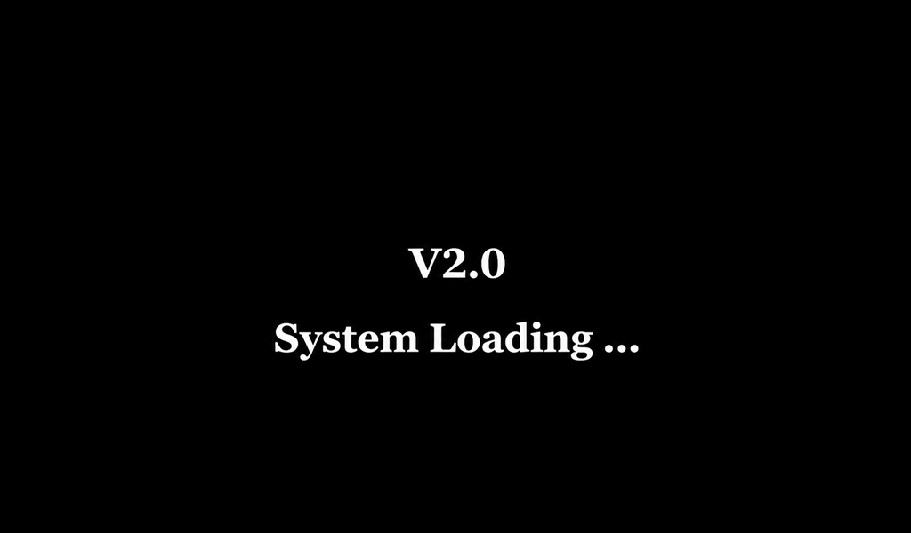
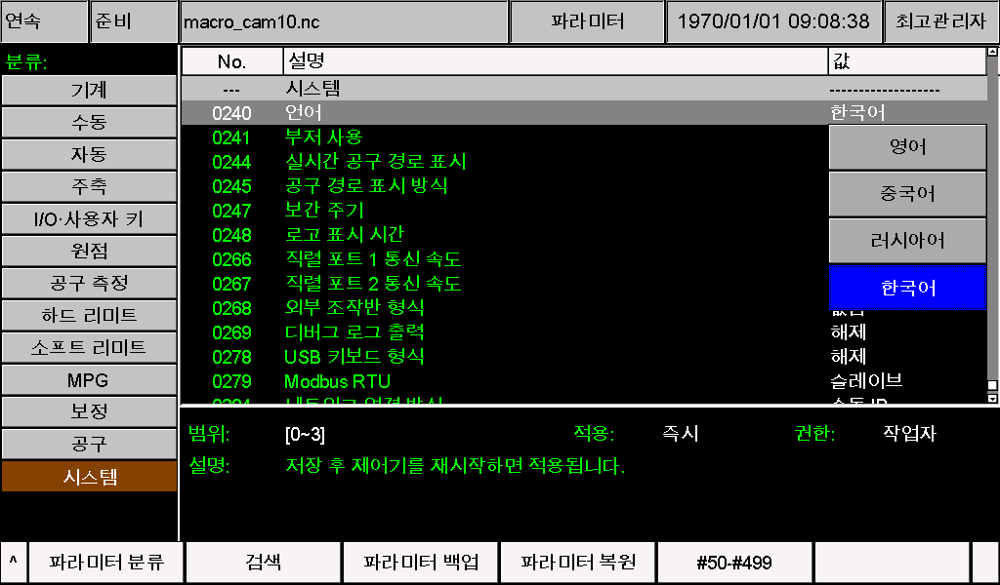
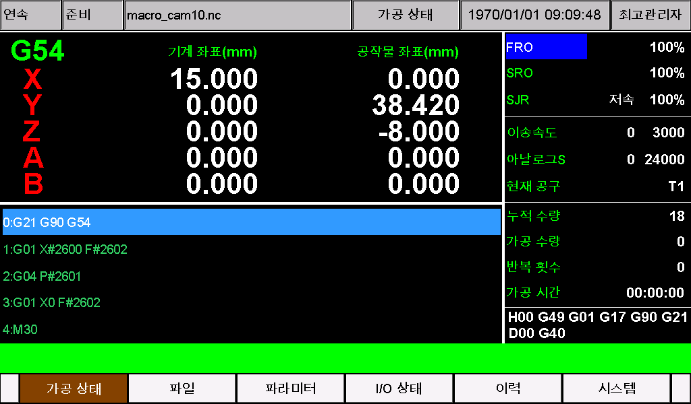

# M350 한국어 언어 팩

M350의 파라미터, 메뉴, 버튼, 상태 표시 및 알람을 한국어로 표시하는 패키지입니다. CNC에서 사용하는 용어를 적용하고, 화면이 좁은 곳은 짧은 표현이나 JOG·MDI·MPG 등의 약어를 사용했습니다.

**대상: M350 V1 / V2, 소프트웨어 버전 2026-10-23-05.** 두 파일을 함께 설치하십시오.

## 빠른 설치 순서

1. 아래 시작 화면으로 V1/V2를 구분하고, 시스템 정보에서 소프트웨어 버전을 확인합니다.
2. 현재 파라미터와 언어 파일을 백업합니다. 기존 CAM·알람·파라미터 사용자 설정이 있다면 먼저 통합합니다.
3. ZIP을 압축 해제합니다. **V1은 `V1` 안의 `install` 폴더, V2는 `V2` 안의 `psys` 폴더 전체를 USB 메모리의 최상위에 복사합니다.**
4. 장비에서 사용하는 리소스 업데이트 절차로 설치합니다.
5. **파라미터 240 = 3**으로 선택하고 저장한 다음 제어기를 재시작합니다.
6. 한국어 표시와 기존 설정을 확인하고 업데이트용 USB 메모리를 제거합니다.

## V1과 V2 구분

전원을 켠 직후 **가장 먼저 나오는 화면**을 확인합니다.

- **V2:** 검은 배경에 흰 글씨로 `V2.0`과 `System Loading ...`가 표시됩니다.
- **V1:** 그 밖의 시작 화면이 표시됩니다.



*하드웨어 식별용 시작 화면 예시입니다. 소프트웨어 버전은 시스템 정보에서 별도로 확인하십시오.*

## 두 파일의 역할

| 파일 | 표시 내용 | V1 | V2 |
| --- | --- | --- | --- |
| `cfg_utf8` | 파라미터 이름, 선택 항목, 단위 및 도움말 | [install/cfg_utf8](V1/install/cfg_utf8) | [psys/cfg_utf8](V2/psys/cfg_utf8) |
| `msg_utf8` | 메뉴, 버튼, 상태, 메시지 및 알람 | [install/msg_utf8](V1/install/msg_utf8) | [psys/msg_utf8](V2/psys/msg_utf8) |

파일 이름은 소문자 그대로 유지하고 `.txt`를 붙이지 마십시오. 인코딩은 **UTF-8(BOM 없음)**, 줄바꿈은 **CRLF**입니다. 파일을 편집하지 않고 복사하면 그대로 사용할 수 있습니다.

> **파일 이름 표시 안내:** 이미 출시된 각 버전의 시스템과 호환되면서 다국어 기능을 지원하기 위해, 추가 언어를 사용할 때 파일 이름의 영문 부분은 정상적으로 표시되지만 비영문 문자 부분은 비정상적으로 표시될 수 있습니다. 그 외 인터페이스와 파라미터의 문자는 정상적으로 표시됩니다.

이 팩은 **240번 파라미터의 3번 사용자 언어**를 사용합니다. 기존에 포르투갈어 등 다른 사용자 언어를 사용 중이라면 이 두 파일을 설치한 뒤 한국어로 바뀝니다. 언어 선택 항목이 추가되거나 두 사용자 언어가 동시에 설치되는 것은 아닙니다.

## 설치 전 준비

- 시스템 정보에서 **2026-10-23-05**인지 확인합니다. 다른 버전은 해당 버전의 원본 파일에 번역을 반영해야 하므로 공급업체에 문의하십시오.
- 가공을 정지하고 장비가 대기 중일 때 설치합니다.
- 현재 파라미터와 언어 파일을 백업하고 240번의 현재 값을 기록합니다.
- 장비 전용 CAM, 알람 문구, 파라미터 이름 또는 기타 사용자 설정은 먼저 이 팩과 통합합니다. 표준 파일로 덮어쓰면 기존 사용자 설정이 사라질 수 있습니다.
- 언어 변경에는 `setting`, `.out` 프로그램 파일 또는 공장 초기화가 필요하지 않습니다.

## USB 메모리 준비

해당 하드웨어용 폴더 **하나만** 복사합니다. 복사 후 USB 메모리를 열었을 때 다음과 같이 보여야 합니다.

**V1:**

```text
USB/
└─ install/
   ├─ cfg_utf8
   └─ msg_utf8
```

**V2:**

```text
USB/
└─ psys/
   ├─ cfg_utf8
   └─ msg_utf8
```

외부 폴더인 `Korean`, `V1`, `V2`를 통째로 USB에 복사하지 마십시오. USB 최상위에 `install` 또는 `psys`가 바로 있어야 합니다. ZIP 파일 자체를 복사하는 것만으로는 설치되지 않습니다. USB에 남아 있는 다른 버전의 프로그램이나 리소스도 확인하십시오.

장비의 기존 설치 절차가 전체 업데이트 패키지를 요구한다면 **같은 버전 2026-10-23-05, 같은 하드웨어**의 패키지에서 두 언어 파일만 교체하여 사용하십시오.

## 설치 및 언어 선택

1. USB를 연결하고 장비에서 사용하는 업데이트 절차로 리소스를 설치합니다. 업데이트가 완료될 때까지 전원을 끄거나 USB를 제거하지 마십시오.
2. 장비 안내에 따라 재시작한 후 파라미터 페이지에서 **240번**을 찾습니다. 현재 언어에 따라 이름은 `Language`, `语言`, `Idioma` 등으로 보일 수 있습니다.
3. **값 3**을 선택합니다. 기존 언어에서는 `Other`, `其他语言`, `Português` 등으로 보일 수 있습니다. 한국어 팩이 적용되면 `한국어`로 표시됩니다.
4. 변경을 확인하고 **저장한 다음 제어기를 재시작**합니다. 공통 적용 시점 칸에 즉시 적용으로 표시되더라도 언어 변경은 재시작해야 합니다.
5. 다시 240번을 열어 값 3이 유지되고 `언어`의 선택 항목이 `한국어`로 표시되는지 확인합니다.



**0240 — 언어**에서 **한국어**는 값 **3**에 해당합니다. 화면의 공통 `적용` 칸에 `즉시`라고 표시되더라도, 언어를 바꾼 뒤에는 아래 설명대로 **저장하고 제어기를 재시작**하십시오.

| 240번 값 | 선택하는 언어 |
| --- | --- |
| 0 | 영어 |
| 1 | 중국어 |
| 2 | 러시아어 |
| **3** | **한국어(이 팩 설치 시)** |

기존 값이 이미 3이면 새 파일을 설치한 후 재시작하여 불러옵니다. 소프트웨어도 업데이트할 예정이라면 먼저 소프트웨어를 업데이트하고, 그 버전에 맞는 언어 팩을 적용하십시오. 나중에 전체 업데이트를 하면 언어 파일이 덮어써질 수 있습니다.

## 처음 사용할 때 확인할 내용



*한국어 팩을 설치한 M350 V2의 메인 화면입니다.*

그림의 좌표, 수량 및 프로그램 내용은 촬영 당시의 장비 상태이며, 그대로 입력해야 하는 설정값이 아닙니다.

생산을 다시 시작하기 전에 다음을 확인하십시오.

- 메인 화면: 한글이 네모나 깨진 글자로 보이지 않고, 버튼·상태·좌표 제목이 잘리지 않는지 확인합니다.
- 240번: 언어 선택 항목과 재시작 안내가 읽히는지 확인합니다.
- 파라미터: 이름·선택 항목·도움말·단위가 표시되고 기존 값이 유지되는지 확인합니다.
- 알람 이력: 메시지의 숫자와 파일 이름이 올바른 위치에 표시되는지 확인합니다. 확인을 위해 고의로 알람이나 축 동작을 발생시킬 필요는 없습니다.
- CAM 및 사용자 화면: 기존 사용자 설정이 유지되는지 확인합니다.

문제가 있으면 **화면 사진, 파라미터/알람 번호, 하드웨어 종류 및 소프트웨어 버전**을 공급업체에 전달하십시오.

## 주요 용어와 약어

| 화면 표기 | 의미 |
| --- | --- |
| 주축 / S | 주축 및 주축 회전수 |
| 정위치 | 주축 정위치 정지(오리엔테이션) |
| 이송 / F | 공구의 이송속도 |
| 원점 복귀 | 기계 기준점을 찾는 동작 |
| 공작물 원점 | 공작물 좌표계의 영점 |
| 기계 / 공작물 | 기계 좌표 / 공작물 좌표 |
| 공구 / 보정 | 공구 및 길이·반경 등의 보정 |
| 클램프 / 언클램프 | 공구 등의 고정 / 고정 해제 |
| MPG | 수동 펄스 발생기(핸들) |
| JOG / MDI | 수동 조그 / 수동 명령 입력 |
| 증분 | 정해진 거리만큼 이동하는 수동 이송 |
| 모의가공 / 시험절삭 | 가공 시뮬레이션 / MPG를 사용하는 시험 가공 |
| FRO / SRO | 이송 / 주축 회전수 오버라이드 |
| IN / OUT | 입력 / 출력 신호 |
| LOW / HIGH | 신호의 낮은 / 높은 논리 레벨 |

축 이름, G/M 코드, 물리 단위, 경로 및 통신 식별자는 필요한 곳에서 원래 표기를 유지합니다. 언어 변경은 실제 가공 단위를 변경하지 않습니다. 표시 단위 설정과 프로그램의 **G20/G21**은 각각의 기능을 유지합니다.

이 팩에는 한글 입력기가 포함되지 않습니다. 파일 이름은 `PART_001.nc`처럼 영문·숫자·밑줄을 사용하고 확장자를 유지하는 것을 권장합니다. NC 프로그램의 주석, 그림 안의 글자 및 일부 고정 표시 문구는 자동으로 번역되지 않습니다.

## 문제 해결 및 이전 언어로 복구

| 증상 | 확인할 사항 |
| --- | --- |
| 한국어로 바뀌지 않음 | USB 폴더 위치, 설치 완료 여부, 240 = 3, 저장 및 재시작 여부 |
| 메뉴만 한국어로 바뀜 | `cfg_utf8`도 올바른 위치에 설치했는지 확인 |
| 파라미터만 한국어로 바뀜 | `msg_utf8`도 올바른 위치에 설치했는지 확인 |
| 글자가 깨지거나 네모로 표시됨 | 두 파일을 원본 ZIP에서 다시 추출하고 버전과 UTF-8 인코딩 확인 |
| 글자가 잘리거나 겹침 | 해당 화면과 번호를 기록하고 사용자 수정 여부 확인 |
| 업데이트 후 한국어가 사라짐 | 새 소프트웨어 버전에 맞는 파일에 번역을 다시 반영 |

화면 조작이 가능하면 240번에서 파일이 정상 설치된 기존 언어를 선택하고 저장한 뒤 재시작합니다. 이전의 사용자 언어(값 3)로 돌아가려면 백업한 `cfg_utf8`와 `msg_utf8`를 함께 복원합니다.

정상 조작이 불가능하면 장비의 리소스 복구 절차와 호환되는 백업 파일을 사용하거나 공급업체에 문의하십시오. 표시 문제를 해결하려고 축 동작 파라미터를 변경하거나 공장 초기화를 실행하지 마십시오.

추후 문서는 [https://docs.foinnccnc.com/](https://docs.foinnccnc.com/)에서 공개될 예정입니다. 기대해 주세요.
