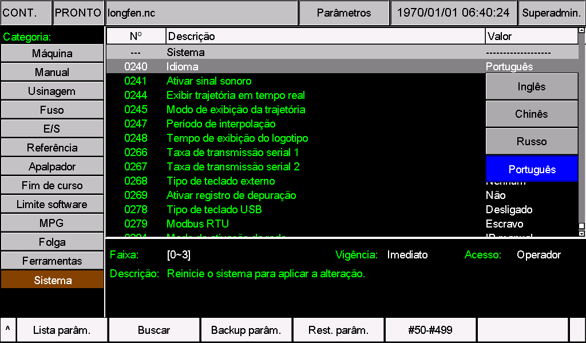
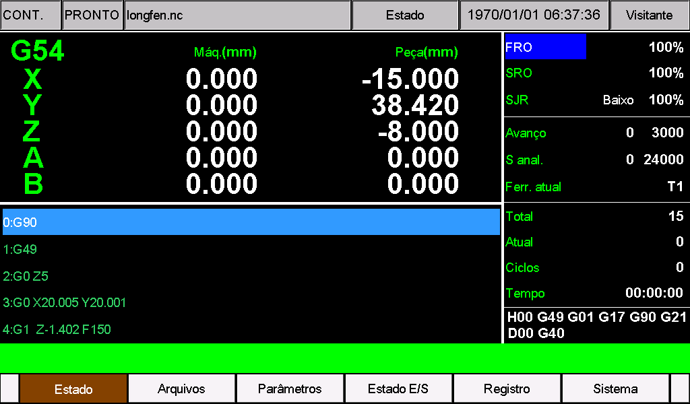

# M350 em português

Este pacote traduz os textos da interface e dos parâmetros do M350 para português, com terminologia de CNC usada no Brasil e abreviações adequadas ao espaço da tela.

**Compatibilidade deste pacote: M350 V1 e V2, software 2026-10-23-05.** Os dois arquivos são completos e devem ser usados em conjunto.

## Arquivos do pacote

| Arquivo | Conteúdo | M350 V1 | M350 V2 |
| --- | --- | --- | --- |
| `cfg_utf8` | Nomes, opções, unidades e explicações dos parâmetros | [V1/install/cfg_utf8](V1/install/cfg_utf8) | [V2/psys/cfg_utf8](V2/psys/cfg_utf8) |
| `msg_utf8` | Menus, botões, estados, mensagens e alarmes | [V1/install/msg_utf8](V1/install/msg_utf8) | [V2/psys/msg_utf8](V2/psys/msg_utf8) |

Os arquivos usam **UTF-8 sem BOM**, com finais de linha **CRLF**. Mantenha os nomes exatamente como estão, em letras minúsculas e sem extensão `.txt`.

**Atenção aos nomes de arquivos:** Para manter a compatibilidade com as versões do sistema já lançadas, ao usar um idioma adicional (**Pr240 = 3, UTF-8**), os caracteres em inglês dos nomes de arquivos são exibidos normalmente, enquanto os caracteres de outros idiomas podem apresentar problemas de exibição. Use letras inglesas sem acentos, números e sublinhados, por exemplo `PART_001.nc`, e mantenha a extensão. Após a instalação, verifique os textos da interface e dos parâmetros; consulte as limitações conhecidas deste pacote.

O pacote ocupa a opção **3 — Outros** do parâmetro 240. Após a instalação, essa opção passa a ser identificada como **Português**. O valor continua sendo **3**.

## Identificar V1 ou V2

Observe a primeira tela exibida ao ligar o controlador:

- **V2:** tela preta com os textos brancos **V2.0** e **System Loading ...**, como na ilustração abaixo.
- **V1:** qualquer outra tela de inicialização.


*Ilustração da tela de inicialização V2.*

Essa tela identifica o hardware. A versão do software deve ser conferida separadamente, conforme a próxima etapa.

## Antes de instalar

1. Confirme na tela de informações do sistema que a versão do software é **2026-10-23-05**.
2. Pare a usinagem e faça a instalação com a máquina ociosa.
3. Faça uma cópia de segurança dos parâmetros e dos arquivos de idioma atuais. Anote o valor atual do parâmetro 240.
4. Se houver menus CAM, nomes de parâmetros, alarmes ou outras configurações personalizadas, combine essas alterações com o pacote antes de instalar.

**Para outra versão de software, não substitua os arquivos diretamente.** Use os arquivos completos da versão instalada como base e incorpore as traduções, preservando seus números, campos e personalizações. O fato de outra versão aceitar UTF-8 não torna este pacote automaticamente compatível.

Instalar estes arquivos substitui o idioma personalizado que já estiver na opção 3. Não cria uma quinta opção de idioma.

Não inclua o arquivo `setting` nem execute restauração de fábrica para trocar o idioma. Também não é necessário acrescentar arquivos de programa `.out` a esta instalação de recursos.

## Preparar o pendrive

Depois de extrair o pacote, abra a pasta correspondente ao seu equipamento:

- **M350 V1:** abra `V1` e copie a pasta **`install` inteira** diretamente para a raiz do pendrive.
- **M350 V2:** abra `V2` e copie a pasta **`psys` inteira** diretamente para a raiz do pendrive.

Os dois arquivos de idioma já estão dentro dessas pastas. Copie somente a pasta de instalação correspondente ao seu hardware. Ao terminar, confira a estrutura no pendrive:

**M350 V1:**

```text
Pendrive/
└─ install/
   ├─ cfg_utf8
   └─ msg_utf8
```

**M350 V2:**

```text
Pendrive/
└─ psys/
   ├─ cfg_utf8
   └─ msg_utf8
```

Na raiz do pendrive deve aparecer diretamente `install` (V1) ou `psys` (V2). Não copie as pastas externas `Portuguese`, `V1` ou `V2` para o pendrive. Verifique se ele não contém recursos ou programas antigos que possam ser instalados por engano.

As estruturas acima mostram somente os arquivos de idioma. Se o procedimento habitual do seu equipamento exigir um pacote completo de atualização, substitua os dois arquivos nesse pacote, usando **a mesma versão 2026-10-23-05 e o hardware correto**.

## Instalar e selecionar português

1. Insira o pendrive e siga o procedimento de atualização já utilizado no equipamento para copiar os recursos.
2. Aguarde a conclusão da atualização e reinicie conforme as instruções do equipamento.
3. Na página de parâmetros, localize o **parâmetro 240**, correspondente ao idioma.
4. Selecione o valor **3**, que pode aparecer como `Other`, `Outros` ou `Português`, conforme o idioma ainda ativo.
5. Confirme e salve a alteração. Reinicie o controlador para carregar os textos em português.
6. Verifique as telas e retire o pendrive de atualização para evitar que os mesmos arquivos sejam instalados novamente em outra partida.



No parâmetro **0240 — Idioma**, a opção **Português** corresponde ao valor **3**. Para a troca de idioma, siga a descrição do parâmetro: **salve e reinicie**, mesmo que o campo geral `Vigência` mostre `Imediato`.

Se o parâmetro 240 já era 3, os novos textos serão carregados na inicialização após a instalação. Não altere o valor para 0, 1 ou 2 para ativar este pacote: esses valores selecionam os recursos de inglês, chinês e russo.

Caso também seja necessário atualizar o software, conclua essa atualização antes de instalar o idioma compatível. Uma atualização completa posterior pode substituir as traduções pelos recursos fornecidos com ela.

## Conferir na primeira utilização



*Tela principal de um M350 V2 com o pacote de português instalado.*

Antes de retomar a produção, confira:

- Menus, teclas e estados: texto legível, sem cortes, sobreposição ou caracteres ausentes.
- Parâmetros: nomes, opções, explicações e unidades corretos; valores e configurações de máquina preservados.
- Mensagens e registros de alarmes: números e nomes de arquivos apresentados nos locais corretos.
- Páginas CAM e outras personalizações: conteúdo próprio mantido após a combinação dos arquivos.
- Parâmetro 240: valor 3 mantido após reiniciar.

Imagens com texto, comentários de programas NC e alguns elementos fixos da interface podem continuar no idioma original. Para os nomes de arquivos, prefira letras sem acentos, números e sublinhado.

## Termos e abreviações

| Termo na tela | Significado |
| --- | --- |
| Avanço / F | Velocidade de avanço da ferramenta |
| Fuso / S | Eixo-árvore e sua rotação |
| Referência / Ref. | Referenciamento dos eixos no sistema da máquina |
| Zero peça | Origem do sistema de coordenadas da peça |
| Pos. máquina / Máq. | Posição no sistema de coordenadas da máquina |
| Ferr. | Ferramenta |
| Vel. | Velocidade |
| Acel. / Desacel. | Aceleração / desaceleração |
| E/S | Entradas e saídas |
| MPG | Volante eletrônico de pulsos |
| FRO / SRO | Ajuste percentual do avanço / da rotação do fuso |
| JOG / MDI | Movimento manual / entrada manual de comandos |

Os símbolos dos eixos, códigos G e M, unidades e identificadores como `IN`, `OUT` e `CAM` são mantidos quando fazem parte da operação. A tradução não altera as unidades efetivas da máquina ou do programa: os ajustes de unidade e os comandos **G20/G21** continuam tendo suas funções próprias.

## Se o idioma não aparecer

| Sintoma | O que verificar |
| --- | --- |
| Nenhuma alteração | Instalação concluída, parâmetro 240 em 3 e reinicialização efetuada |
| Só os menus mudaram | `cfg_utf8` também foi copiado para o local correto |
| Só os parâmetros mudaram | `msg_utf8` também foi copiado para o local correto |
| Acentos incorretos | Ambos os arquivos continuam em UTF-8 sem BOM e não foram salvos em outra codificação |
| Texto cortado ou sobreposto | Tela e frase afetadas; se o arquivo foi personalizado, reduza a frase preservando o sentido |
| Traduções desapareceram após atualizar | O pacote de atualização substituiu os recursos; combine novamente com os arquivos da nova versão |

## Voltar ao idioma anterior

Se a interface estiver acessível, selecione no parâmetro 240 um idioma cujos arquivos estejam instalados e funcionando, salve e reinicie. Para recuperar o idioma personalizado anterior da opção 3, reinstale as duas cópias de segurança compatíveis com a versão do equipamento e reinicie.

Se a interface não permitir a operação normal, utilize o procedimento de recuperação de recursos do equipamento com os arquivos de segurança ou procure o fornecedor. Não tente corrigir a exibição alterando parâmetros de movimento ou restaurando a máquina para os valores de fábrica.

A documentação futura será publicada em [https://docs.foinnccnc.com/](https://docs.foinnccnc.com/). Fique atento às novidades.
