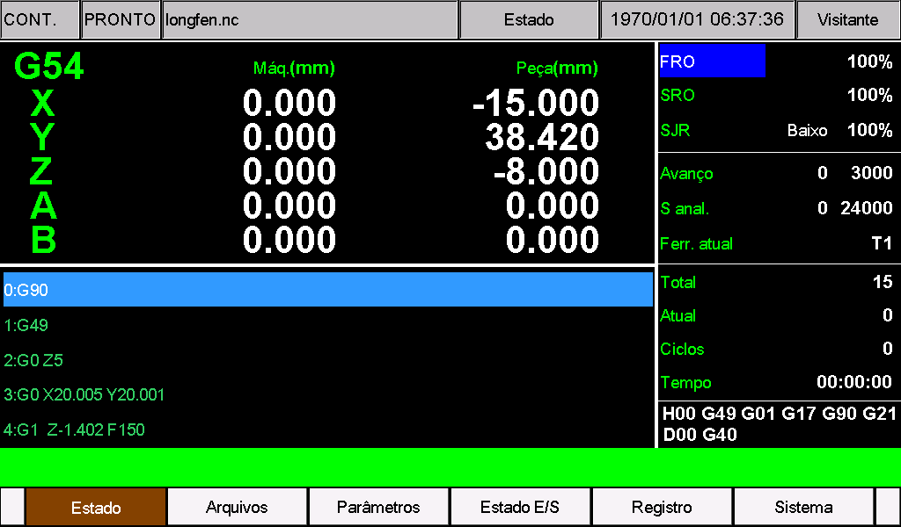
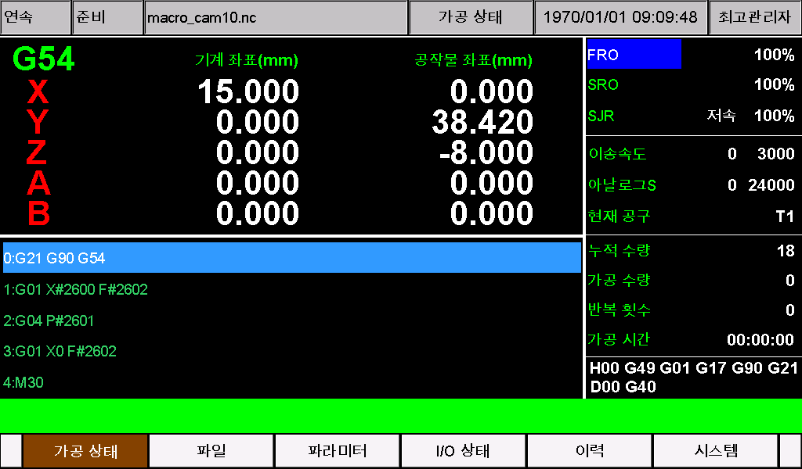
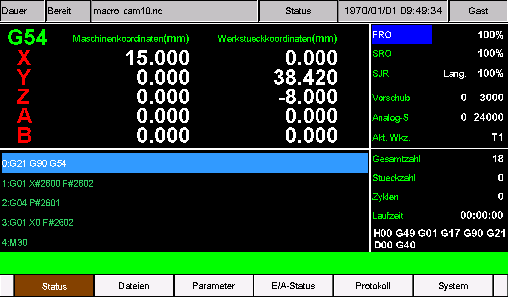
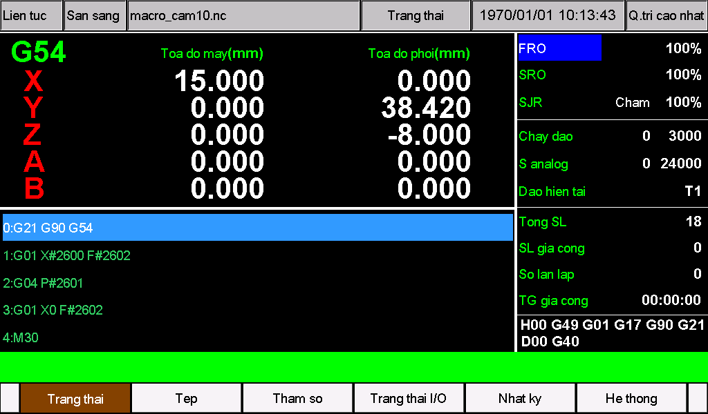
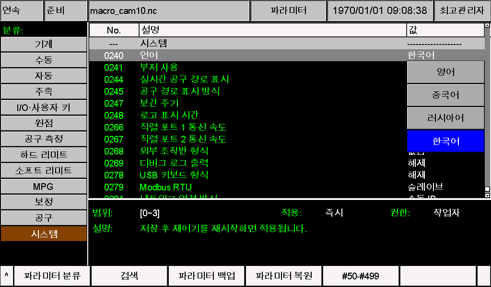
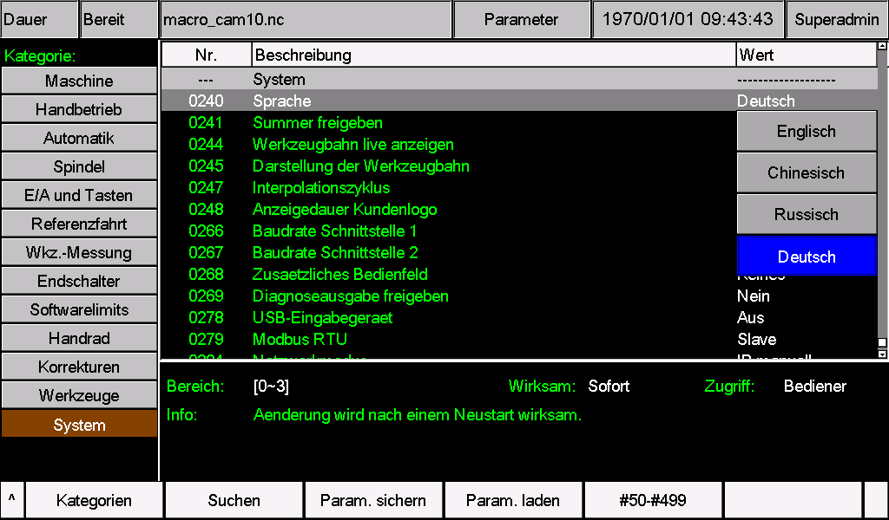
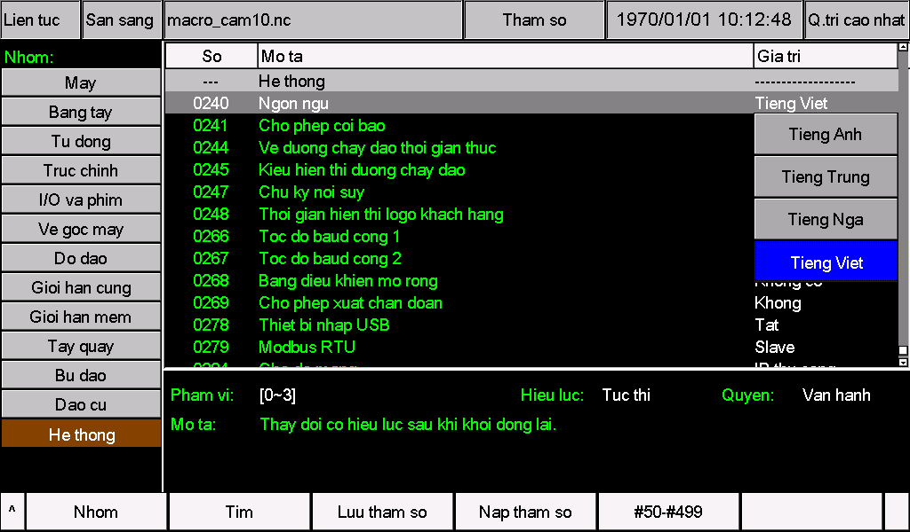

# M350 Language Support Overview and User Guide

[简体中文](README.zh-CN.md) | English

This guide explains how to select an M350 interface language and translate, install, and check a custom language pack. It applies to M350 V1 and V2 hardware. Custom UTF-8 language resources are supported in software **2024-12-12-00 and later**. For earlier versions, first check whether parameter 240 includes the “Other language” option.

To use an existing pack, follow the language selection and installation instructions below. To create a translation, start with complete resource files for the controller's software version. Language packs change parameter names, menus, and messages; they do not automatically translate NC programs or text embedded in images.

This directory contains the Chinese and English overview guides. Each language folder and downloadable pack contains its installation guide only in that language, together with the resource files and illustrations.

### Interface previews

These are actual M350 V2 screens, grouped into main screens and parameter 240 language-selection pages. Click an image to view it at full size, or a language name to open its installation guide.

#### Main screens

| [Portuguese · Português](Portuguese/README.md) | [Korean · 한국어](Korean/README.md) |
| --- | --- |
| [](Portuguese/images/02-main-screen.png) | [](Korean/images/02-main-screen.png) |

| [German · Deutsch](German/README.md) | [Vietnamese · Tiếng Việt](Vietnamese/README.md) |
| --- | --- |
| [](German/images/02-main-screen.png) | [](Vietnamese/images/02-main-screen.png) |

#### Parameter 240 language selection

| [Portuguese · Português](Portuguese/README.md) | [Korean · 한국어](Korean/README.md) |
| --- | --- |
| [](Portuguese/images/01-language-selection.png) | [](Korean/images/01-language-selection.png) |

| [German · Deutsch](German/README.md) | [Vietnamese · Tiếng Việt](Vietnamese/README.md) |
| --- | --- |
| [](German/images/01-language-selection.png) | [](Vietnamese/images/01-language-selection.png) |

### Available language packs

| Language | Matching software version | Files and instructions |
| --- | --- | --- |
| Portuguese (Brazilian CNC terminology) | 2026-10-23-05, V1/V2 | [Portuguese guide](Portuguese/README.md) · [V1 folder](Portuguese/V1/install/) · [V2 folder](Portuguese/V2/psys/) · [Download pack](Portuguese/M350-Portuguese-2026-10-23-05.zip) |
| Korean (Korean CNC terminology) | 2026-10-23-05, V1/V2 | [Korean guide](Korean/README.md) · [V1 folder](Korean/V1/install/) · [V2 folder](Korean/V2/psys/) · [Download pack](Korean/M350-Korean-2026-10-23-05.zip) |
| German (German CNC terminology) | 2026-10-23-05, V1/V2 | [German guide](German/README.md) · [V1 folder](German/V1/install/) · [V2 folder](German/V2/psys/) · [Download pack](German/M350-German-2026-10-23-05.zip) |
| Vietnamese (Vietnamese CNC terminology) | 2026-10-23-05, V1/V2 | [Vietnamese guide](Vietnamese/README.md) · [V1 folder](Vietnamese/V1/install/) · [V2 folder](Vietnamese/V2/psys/) · [Download pack](Vietnamese/M350-Vietnamese-2026-10-23-05.zip) |

Extract the required pack. **For V1, copy the entire `install` folder inside `V1` to the USB drive's root. For V2, copy the entire `psys` folder inside `V2` to the USB drive's root.** The two resource files are already in the correct folders. Copy only the folder for your hardware; do not copy the outer `V1`, `V2`, or language folder (such as `Portuguese`, `Korean`, `German`, or `Vietnamese`) to the USB drive.

All packs use **parameter 240 = 3** and replace the existing “Other language” resources. Only one custom language can occupy this slot at a time. Always install both files from the same pack; installing a pack does not add a language option. Check the software version and make a backup first. Merge any existing CAM, alarm, or parameter customizations before installation. For another software version, merge the translations into that version's complete resource files instead of overwriting them with these packs.

After installation, **set parameter 240 to 3, save, and restart**. To update an installed language pack, update both files through the same installation procedure, then restart the controller. See the guides in the table for instructions and common abbreviations in each language.

**Note: filename display**

To maintain multilingual compatibility across released system versions, when using an added language, the English-letter portion of a filename continues to display normally, while non-English characters may display incorrectly. Text elsewhere in the interface and parameters displays normally.

## Identify V1 or V2 at startup

Watch the first screen that appears when the controller is powered on:

- **V2:** white `V2.0` and `System Loading ...` text on a black background, as illustrated below. Use the `psys` folder.
- **V1:** any other startup screen. Use the `install` folder.


This identifies the hardware generation. Check the software version separately on the system management page.

## 1. Select a language

**Parameter 240, Language**, selects the language resources loaded at startup. Its number remains the same even when its displayed name changes with the interface language.

| Parameter 240 value | Interface language | Parameter definition file | Menu and message file | File encoding |
| --- | --- | --- | --- | --- |
| 0 | English | `eng` | `msg1` | Preserve the original encoding |
| 1 | Chinese | `chs` | `msg` | Preserve the original encoding |
| 2 | Russian | `rus` | `msg2` | Preserve the original encoding |
| 3 | Other language | `cfg_utf8` | `msg_utf8` | UTF-8 without BOM |

Find parameter 240 on the parameter page, set the required value, save it, and restart the controller. Before switching, make sure both files for that language are installed.

“Other language” is a single custom language slot whose contents come from `cfg_utf8` and `msg_utf8`. Selecting 3 does not translate text automatically or open a new list of languages. To use a different custom language, replace both files and restart.

## 2. Prepare the original files

1. Check the controller's software version on the system management page and identify its hardware as V1 or V2.
2. Back up the current parameters and custom resources. Record the current value of parameter 240.
3. Obtain a complete upgrade package matching the controller's actual software version. Language resources are in `install` for V1 and `psys` for V2.
4. Copy both files to a working folder on your computer and keep an untouched backup. If the machine already has custom resources, use or merge those resources from the same software version.
5. Open the files in a plain-text editor that lets you explicitly select the encoding.

**Edit complete files from the matching software version.** Do not replace a complete file with the few sample lines in this guide. Files from another version may omit newer menus, parameters, or machine-specific customizations.

For a new custom language, start with the existing `cfg_utf8` and `msg_utf8`. These files may contain examples in several languages; translate the required entries individually rather than assuming they already form a finished language pack.

Keep the filenames exactly as listed, including letter case, and do not add `.txt`. When downloading from GitHub, obtain the raw files or extract the complete package; do not save the webpage itself as a resource file.

## 3. Translate parameter text

Parameter definition files contain names, units, help text, and option labels, as well as parameter types, ranges, and groups. **Translate text only; preserve IDs and control fields.**

| Field | Purpose | Translation rule |
| --- | --- | --- |
| `#number` | Parameter ID | Keep the original ID |
| `-s1"text"` | Parameter name | Translate concisely |
| `-s2"text"` | Unit label | Preserve the unit, scale, and physical meaning |
| `-s3"text"` | Parameter help | Translate while preserving values, commands, and separators |
| `-i0"text"`, `-i1"text"`, etc. | Option labels | Translate while preserving option indices and order |
| `-p`, `-a`, `-t`, `-m`, `-min=`, `-max=`, `=value` | Access level, axis configuration, type, group, range, and assigned value | Preserve exactly as in the original file |

For example, a matching original file may contain:

```text
#12 -p0 -a3 -t2 -s1"X-axis direction port electric level" -m1 -min=0.000 -max=1.000 -i0"low" -i1"high"
-s3"This parameter is used to determine the direction of X-axis motion."
```

A Spanish translation can change the text at the same location:

```text
#12 -p0 -a3 -t2 -s1"Nivel de dirección X" -m1 -min=0.000 -max=1.000 -i0"Bajo" -i1"Alto"
-s3"Este parámetro determina el sentido de movimiento del eje X."
```

This example demonstrates text editing only; it is not an installable parameter file. Do not change your version's control fields to match the example.

When editing:

- Preserve the opening and closing `&&` markers. Keep markers and `#number` entries at their original line starts.
- Use straight ASCII double quotes `"`, not typographic quotation marks. Do not insert extra double quotes inside a string.
- Keep each quoted string on one physical line. Preserve `/` and other display separators.
- Each option label, `-i0` through `-i7`, must fit within **19 UTF-8 bytes**. A character may occupy several bytes, so this is not a 19-character limit. Use short option labels.
- Other individual quoted strings must not exceed **519 bytes**. Screen space usually requires much shorter text. Keep help text focused on the operation.
- When translating parameter 240's options, preserve the mapping **0 = English, 1 = Chinese, 2 = Russian, 3 = Other language**.

Changing a translated unit label does not change the controller's actual units. Translation does not change the function of `G20` or `G21`.

## 4. Translate menus and messages

An ordinary menu or message entry has this format:

```text
#20 "READY"
```

Replace only the text inside the double quotes. For example, a Spanish translation in the original `msg_utf8` file could be:

```text
#20 "LISTO"
```

Parameter files and message files have independent ID numbering. Do not exchange entries between the two files just because their IDs match.

### Preserve formatting and functional characters

1. Keep the opening and closing `$$` markers, entry IDs, entry order, and original line starts.
2. Preserve dynamic placeholders such as `%d`, `%s`, and `%.3f`, including their count, type, and order. Keep their ASCII characters unchanged.
3. Preserve `/`, spaces, and other display separators. Do not add physical line breaks, tabs, or extra double quotes inside strings.
4. Preserve G/M codes, axis names, formulas, program fragments, numeric options, and formatting characters. Items such as `G01`, `X`, `F#561`, and `[]` can affect operation and must not be treated as ordinary prose.
5. Alarm entries may repeat `#1000` and contain fields such as `-t1=number`. Preserve these repeated IDs, fields, and their order. Translate only the alarm text; do not remove duplicates or renumber entries.

For example:

```text
#102 "BreakPoint%d:%s L:%d"
```

The words may be translated, but the three placeholders must remain in the order `%d`, `%s`, `%d`.

Keep menu names, button labels, and status messages brief. Use CNC terminology and familiar abbreviations in the target language. Correct file syntax does not guarantee that text fits on a button or screen; check the translated pages on the controller.

## 5. Save files and check encoding

Save **both `cfg_utf8` and `msg_utf8` as UTF-8 without BOM**, preserving the original line endings and filenames. Renaming files does not convert their encoding or translate their contents.

When editing `eng`, `msg1`, `chs`, `msg`, `rus`, or `msg2`, preserve each file's original encoding and line endings. An editor's “ANSI” label depends on the computer's configuration; do not use that label as a reason to convert all files to one encoding. If text is already garbled when opened, identify the correct encoding before editing and do not save the corrupted display back to the file.

Close and reopen the saved files to check letters, accents, and other characters. Compare them with the backup to confirm that only the intended text changed and that no entries, quotes, markers, or placeholders were lost.

## 6. Install a language pack

The examples below use the custom language files. For modified built-in languages, use the corresponding filenames in section 1.

### V1 USB layout

```text
USB drive root/
└─ install/
   ├─ cfg_utf8
   └─ msg_utf8
```

### V2 USB layout

```text
USB drive root/
└─ psys/
   ├─ cfg_utf8
   └─ msg_utf8
```

These diagrams show where the language resources belong. Install them using the controller's existing system update procedure. If that procedure requires a complete upgrade package, replace the two files in a package for **the same software version and the correct hardware** before updating.

1. Stop machining. With the machine idle, back up its parameters and original language files.
2. Remove old or unrelated update contents from the USB drive to avoid installing another version's programs or configuration. Use `install` for V1 or `psys` for V2 directly at the drive root, with no extra enclosing folder.
3. Copy the complete edited files into the correct folder. Check their names and encoding.
4. Follow the machine's normal system update procedure. Wait for completion and restart as instructed.
5. Set parameter 240 to `3`, save, and restart to apply the selection. If it is already 3, the startup after installation loads the new custom resources.
6. Once the language displays correctly, remove the update USB drive so a later startup does not overwrite subsequent resource changes.

**Do not add a `setting` file or restore factory parameters just to install language resources.** If you are also updating software, complete the software update first, then install language resources based on that version so that the complete upgrade package does not overwrite the translated text.

Installing language resources does not add fonts or change the controller's software version. V1 and V2 program files are not interchangeable. Do not install another hardware generation's `.out` files for a language change.

## 7. Check the display

Check the interface and parameters before resuming normal use. These checks do not require starting motion or deliberately triggering alarms.

| Location | What to check |
| --- | --- |
| Parameter 240 | The selected value is correct and remains set after restart |
| Main screen and function menus | Menus, buttons, and status text are readable without clipping or overlap |
| Parameter pages | Names, units, help, and options are correct; actual parameter values and ranges still match the machine configuration |
| Messages and existing alarm history | Meaning is clear; dynamic numbers and filenames appear in the correct positions |
| Custom pages and CAM menus | Existing custom names are retained and the resources for the selected language are updated |
| File list | Common filenames are readable; use ASCII letters, digits, and underscores if needed |

UTF-8 is a file encoding, not a guarantee that every Unicode character can be displayed. Results depend on the controller's installed fonts and text rendering. Check missing characters, boxes, combining marks, complex scripts, and right-to-left text on the target hardware. Try short text using common characters first; ask the equipment supplier about font support if necessary.

A language pack covers text provided through the resource files. Text embedded in images, NC program comments, some fixed interface elements, and filenames may not change with the language selection. Translating these two files alone does not guarantee that every part of the system is localized.

## 8. Troubleshooting and recovery

| Symptom | Action |
| --- | --- |
| The interface does not change | Check parameter 240, filenames, and the V1/V2 folder. Confirm that the update completed and the controller restarted |
| Menus change, but parameter names do not | Check that the parameter definition file, such as `cfg_utf8`, was also edited and installed |
| Parameter names change, but menus do not | Check that the message file, such as `msg_utf8`, was also edited and installed |
| Text is garbled | Check the actual saved encoding. Both custom files require UTF-8 without BOM; built-in language files retain their original encoding |
| Characters are missing or appear as boxes | Check font support, try common characters, and verify on the target hardware |
| Text is clipped or overlaps | Shorten the translation, use familiar CNC abbreviations, and check option labels' UTF-8 byte counts |
| Entries are missing, misplaced, or abnormal | Check quotes, `&&`, `$$`, IDs at line starts, alarm order, and placeholders against a same-version backup |
| Translations disappear after a software update | Merge them into the new version's complete resource files and reinstall. Do not overwrite the new files with an older version's files |
| Non-ASCII filenames display incorrectly | Use ASCII letters, digits, and underscores. A language pack does not configure filename encoding |

To recover while the interface is usable, set parameter 240 to an installed language known to work, save, and restart. Alternatively, restore the complete backed-up language files for the same software version through the normal update procedure. If the interface is unusable, follow the equipment's resource recovery procedure using your backup and contact the supplier if needed. Do not change unrelated parameters or restore factory settings blindly.

## 9. More documentation

- [M350 Custom CAM User Guide](../CAM-Guide/README.md)

Future documentation will be published at [https://docs.foinnccnc.com/](https://docs.foinnccnc.com/). Stay tuned.
