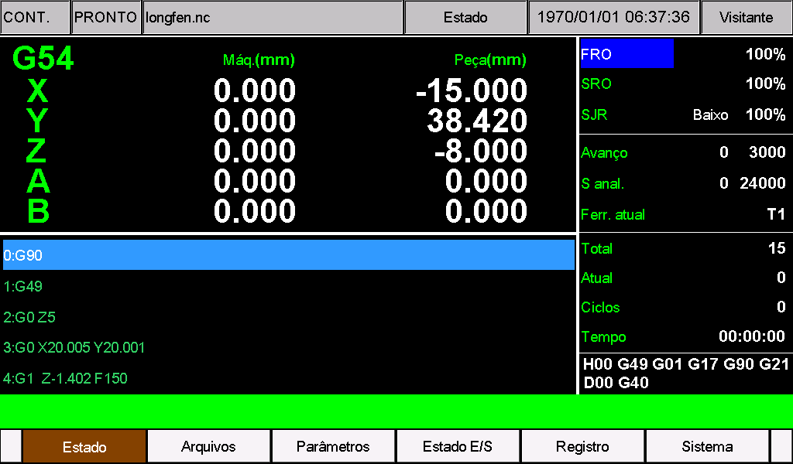
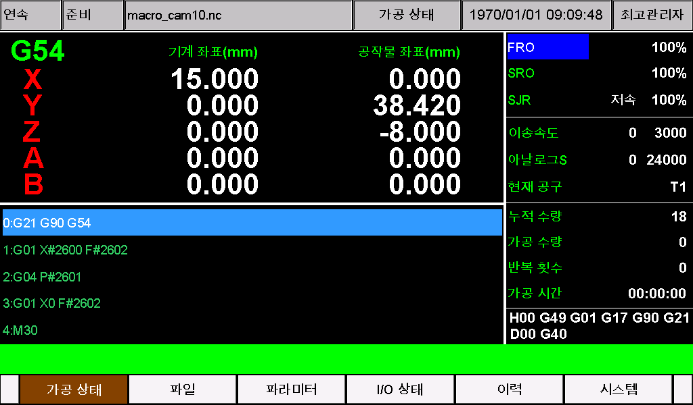
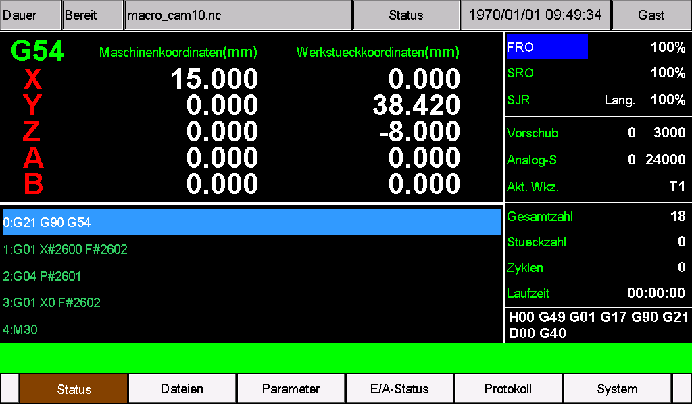
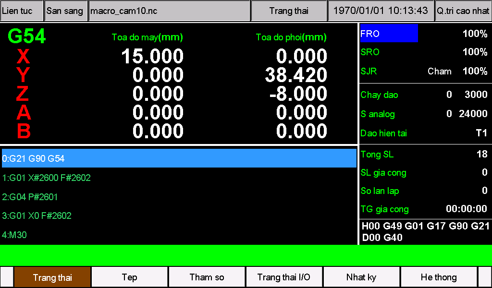
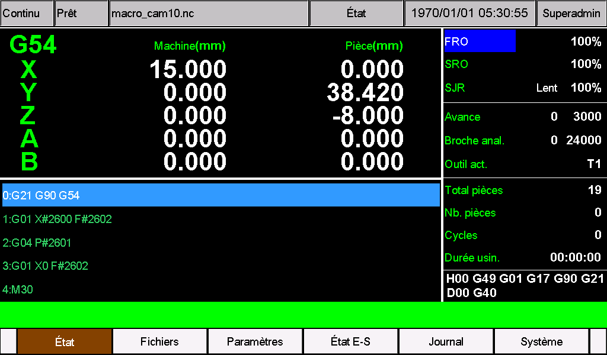
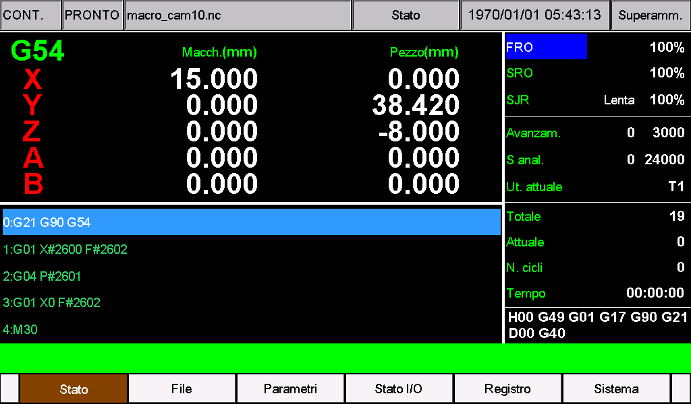
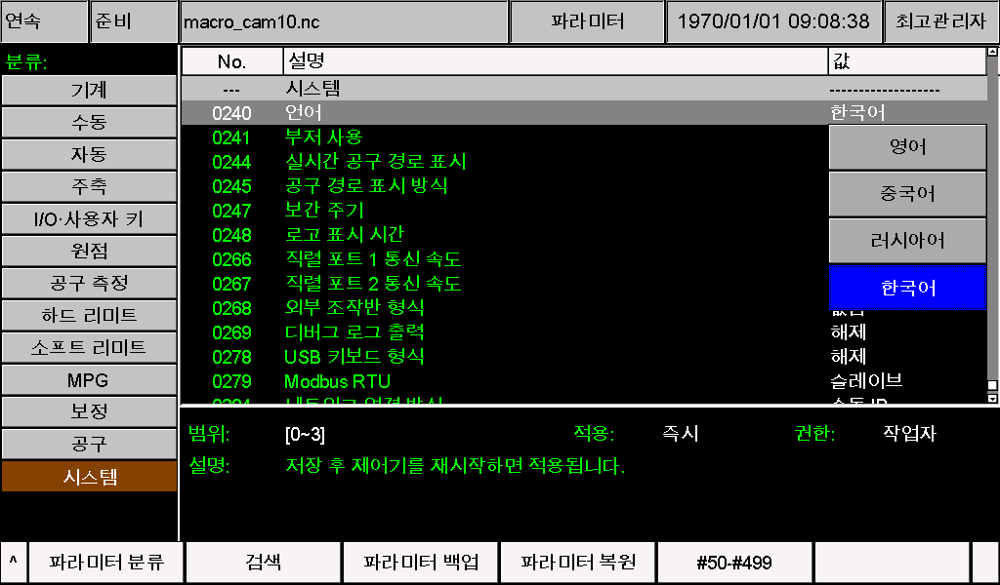
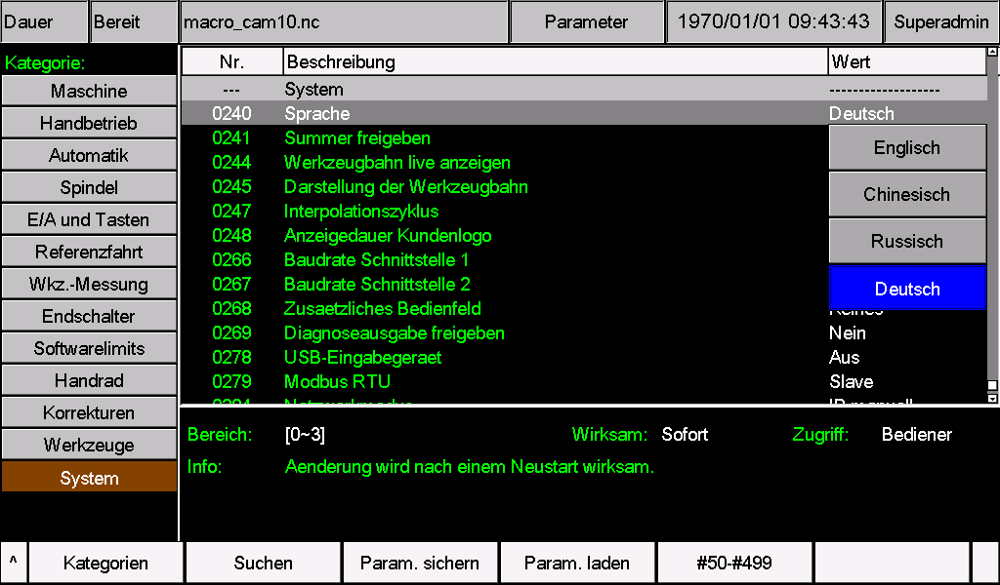
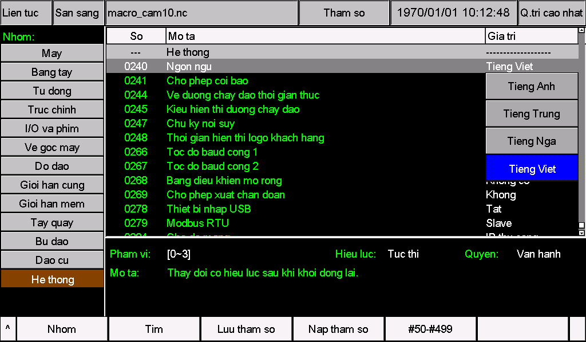
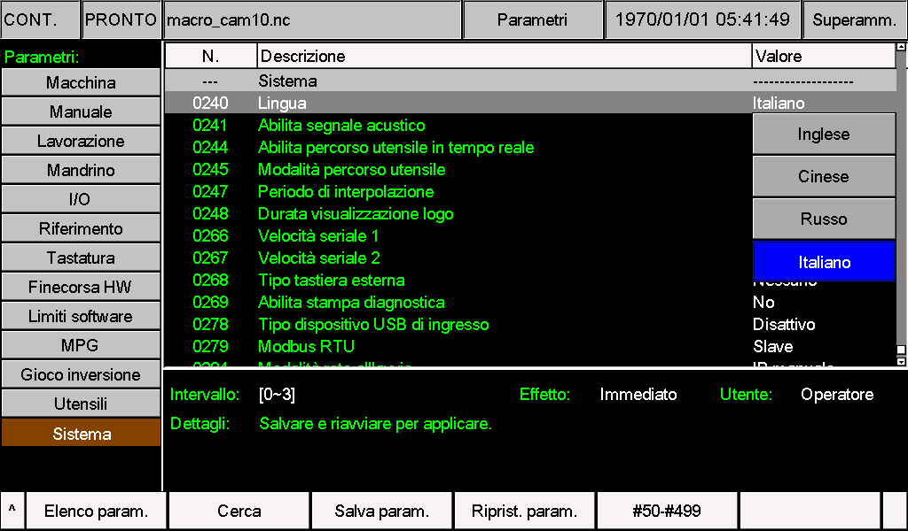

# M350 多语言支持总览与使用说明

简体中文 | [English](README.md)

本说明介绍如何切换 M350 界面语言，以及如何翻译、安装和检查自定义语言包。适用硬件为 M350 V1、V2；自定义其他语言的 UTF-8 功能适用于 **2024-12-12-00（含）及之后版本**。较早版本请先确认是否具备 240 号参数的“其他语言”选项。

已有语言包时，按“选择语言”和“安装语言包”操作；需要自行翻译时，先准备同版本原文件，再按本文修改。语言包用于修改参数名称、菜单和提示文字，不会自动翻译加工程序或图片中的文字。

本目录提供中文和英文总览。各语种文件夹及下载包内只保留对应语言的安装说明、配置文件和配图。

### 语言界面预览

以下为 M350 V2 的实机画面，分为主界面和 240 号语言参数页两组。点击图片查看原图，点击语言名称打开安装说明。

#### 主界面

| [葡萄牙语 · Português](Portuguese/README.md) | [韩语 · 한국어](Korean/README.md) |
| --- | --- |
| [](Portuguese/images/02-main-screen.png) | [](Korean/images/02-main-screen.png) |

| [德语 · Deutsch](German/README.md) | [越南语 · Tiếng Việt](Vietnamese/README.md) |
| --- | --- |
| [](German/images/02-main-screen.png) | [](Vietnamese/images/02-main-screen.png) |

| [法语 · Français](French/README.md) | [意大利语 · Italiano](Italian/README.md) |
| --- | --- |
| [](French/images/02-main-screen.png) | [](Italian/images/02-main-screen.png) |

#### 240 号语言参数页

| [葡萄牙语 · Português](Portuguese/README.md) | [韩语 · 한국어](Korean/README.md) |
| --- | --- |
| [](Portuguese/images/01-language-selection.png) | [](Korean/images/01-language-selection.png) |

| [德语 · Deutsch](German/README.md) | [越南语 · Tiếng Việt](Vietnamese/README.md) |
| --- | --- |
| [](German/images/01-language-selection.png) | [](Vietnamese/images/01-language-selection.png) |

| [法语 · Français](French/README.md) | [意大利语 · Italiano](Italian/README.md) |
| --- | --- |
| [](French/images/01-language-selection.png) | [](Italian/images/01-language-selection.png) |

### 配套语言包

下载包统一使用 `M350-语言名.zip`，文件名不带日期或版本后缀。配套软件版本请查看下表及包内说明书。

| 语言 | 配套软件版本 | 文件与使用说明 |
| --- | --- | --- |
| 葡萄牙语（巴西 CNC 常用术语） | 2026-10-23-05，V1/V2 | [葡萄牙语安装说明](Portuguese/README.md) · [V1 文件夹](Portuguese/V1/install/) · [V2 文件夹](Portuguese/V2/psys/) · [下载配置包](Portuguese/M350-Portuguese.zip) |
| 韩语（韩国 CNC 常用术语） | 2026-11-05-02，V1/V2 | [韩文安装说明](Korean/README.md) · [V1 文件夹](Korean/V1/install/) · [V2 文件夹](Korean/V2/psys/) · [下载配置包](Korean/M350-Korean.zip) |
| 德语（德语 CNC 常用术语） | 2026-10-23-05，V1/V2 | [德文安装说明](German/README.md) · [V1 文件夹](German/V1/install/) · [V2 文件夹](German/V2/psys/) · [下载配置包](German/M350-German.zip) |
| 越南语（越南 CNC 常用术语） | 2026-10-23-05，V1/V2 | [越文安装说明](Vietnamese/README.md) · [V1 文件夹](Vietnamese/V1/install/) · [V2 文件夹](Vietnamese/V2/psys/) · [下载配置包](Vietnamese/M350-Vietnamese.zip) |
| 法语（法国 CNC 常用术语） | 2026-11-05-02，V1/V2 | [法文安装说明](French/README.md) · [V1 文件夹](French/V1/install/) · [V2 文件夹](French/V2/psys/) · [下载配置包](French/M350-French.zip) |
| 意大利语（意大利 CNC 常用术语） | 2026-11-05-02，V1/V2 | [意大利文安装说明](Italian/README.md) · [V1 文件夹](Italian/V1/install/) · [V2 文件夹](Italian/V2/psys/) · [下载配置包](Italian/M350-Italian.zip) |

**法语与意大利语：** 配套软件为 **2026-11-05-02**，保留各自语言的重音字母。两份说明均已加入该版本 M350 V2 的语言选择页和主界面实机图。请按对应语言的说明配套安装两份资源，设置 240=3，保存并重启。开机示意图用于识别硬件，软件版本请在系统信息中单独确认。

**韩语更新（2026-11-05-02）：** 通用弹窗标题为 `메시지`（[弹窗示例](Korean/images/03-korean-dialog-title.png)）；三条权限密码输入提示存在原有超宽问题。上方韩文主界面、240 页图片为此前版本的操作示例。

解压所需语言的配置包后，**V1 用户将 `V1` 内的整个 `install` 文件夹复制到 U 盘根目录；V2 用户将 `V2` 内的整个 `psys` 文件夹复制到 U 盘根目录**。两个配置文件已放在对应位置。只复制本机硬件对应的文件夹，不要把外层 `V1`、`V2` 或语种文件夹（如 `Portuguese`、`Korean`、`German`、`Vietnamese`）一起复制到 U 盘。

这些包都使用 **240 = 3**，会替换“其他语言”位置的现有资源。同一时间使用一种自定义语言，两个文件必须来自同一语言包；不会新增语言选项。先核对软件版本并备份；已有 CAM、报警或参数定制时，先合并这些内容再安装。其他软件版本请以其同版本资源为基础合并译文，不要直接覆盖。

安装后，将 **240 号参数设为 3，保存并重启**。更新已安装的语言包时，按原安装流程同时更新两个文件，再重启控制器。各语种的具体操作和常用缩写，请查看表中的安装说明。

**注意：文件名显示**

为了兼容已发布的各版本系统并支持多国语言功能，使用新增语种时，文件名的英文部分仍可正常显示，非英文字符部分可能显示异常。界面和参数中的文字显示仍需按下文检查，具体语言包的已知限制见对应说明。

## 开机时确认 V1 或 V2

观察控制器开机最先出现的启动画面：

- **V2：**黑底白字，显示 `V2.0` 和 `System Loading ...`，如下图。安装资源使用 `psys` 文件夹。
- **V1：**显示其他启动画面。安装资源使用 `install` 文件夹。


## 1 选择语言

**240 号参数 Language（语言）**决定启动时加载的语言资源。参数编号相同，界面上的名称可能因当前语言不同而变化。

| 240 号参数值 | 界面语言 | 参数定义文件 | 菜单及提示文字文件 | 保存编码 |
| --- | --- | --- | --- | --- |
| 0 | 英文 | `eng` | `msg1` | 保留原文件编码 |
| 1 | 中文 | `chs` | `msg` | 保留原文件编码 |
| 2 | 俄文 | `rus` | `msg2` | 保留原文件编码 |
| 3 | 其他语言 | `cfg_utf8` | `msg_utf8` | UTF-8 无 BOM |

在参数页面找到 240 号参数，设置所需数值并保存，重启控制器后生效。切换前应确认对应的两个资源文件已正确安装。

“其他语言”是一个自定义语言位置，显示内容由 `cfg_utf8`、`msg_utf8` 决定。选择 3 不会自动翻译，也不会出现新的语种列表；需要换另一种自定义语言时，替换这两个文件后重启。

## 2 准备原文件

1. 在系统管理页面确认控制器的软件版本，并确认硬件为 V1 还是 V2。
2. 备份当前参数及已有定制资源，记录当前 240 号参数值。
3. 取得与设备实际软件版本相同的完整升级包。V1 在 `install` 中找语言资源，V2 在 `psys` 中找语言资源。
4. 将需要修改的两个文件复制到电脑工作目录，另存一份未修改的备份。如果设备已有定制，应使用或合并设备现有的同版本资源。
5. 使用能明确选择文件编码的纯文本编辑器打开文件。

**使用完整的同版本文件进行修改。** 不要用本文中的几行示例覆盖完整文件，也不要直接拿其他版本语言包替换本机资源。不同版本的条目可能不同，覆盖后可能丢失新增菜单、参数或设备定制内容。

新增语种使用原有的 `cfg_utf8`、`msg_utf8` 作为基础。文件中可能包含多种语言的演示文字，应逐项翻译成目标语言，不能把它当作已经完成的单一语种语言包。

文件名保持表中原样，区分大小写，不加 `.txt`。不要把 GitHub 网页另存为资源文件；如从网页下载，应下载原始文件或完整升级包后解压。

## 3 修改参数文字

参数定义文件包含名称、单位、帮助说明和选项文字，也包含参数类型、范围及分组等设置。**翻译时只修改需要翻译的文字，保留编号和控制字段。**

| 字段 | 内容 | 翻译要求 |
| --- | --- | --- |
| `#编号` | 参数编号 | 保留原编号 |
| `-s1"文字"` | 参数名称 | 可翻译，尽量简短 |
| `-s2"文字"` | 单位文字 | 保留正确单位，不改变比例或物理含义 |
| `-s3"文字"` | 参数帮助说明 | 可翻译，保留数值、指令及原有分隔符 |
| `-i0"文字"`、`-i1"文字"` 等 | 选项名称 | 可翻译，保留选项编号及顺序 |
| `-p`、`-a`、`-t`、`-m`、`-min=`、`-max=`、`=数值` | 权限、轴配置、类型、分组、范围及赋值等 | 按原文件保留 |

例如，同版本原文件中有以下条目：

```text
#12 -p0 -a3 -t2 -s1"X-axis direction port electric level" -m1 -min=0.000 -max=1.000 -i0"low" -i1"high"
-s3"This parameter is used to determine the direction of X-axis motion."
```

翻译成西班牙语时，可在原文件对应位置修改为：

```text
#12 -p0 -a3 -t2 -s1"Nivel de dirección X" -m1 -min=0.000 -max=1.000 -i0"Bajo" -i1"Alto"
-s3"Este parámetro determina el sentido de movimiento del eje X."
```

此例只演示文字修改方法，不是可单独安装的参数文件。不要为匹配示例而改动本机版本的其他字段。

保存时注意：

- 保留文件开头和结尾的 `&&` 标记；标记及 `#编号` 应保持在原来的行首位置。
- 使用英文半角双引号 `"` 包围文字，不要换成中文引号或在文字内部插入双引号。
- 一段引号内的文字保持在同一物理行中，保留原有 `/` 等用于显示分隔的符号。
- 选项文字 `-i0`～`-i7` 每项最多 **19 字节**。UTF-8 字符可能占多个字节，因此不能按 19 个汉字或其他文字计算；应使用简短选项名称。
- 其他单段引号内文字不超过 **519 字节**，实际还应根据屏幕空间缩短。长帮助说明优先保留操作含义，不要堆入整篇说明。
- 翻译 240 号参数的选项时，仍须保持 **0 英文、1 中文、2 俄文、3 其他语言** 的对应关系。

## 4 修改菜单和提示文字

菜单及提示文字文件中，一般条目采用以下格式：

```text
#20 "READY"
```

只替换双引号中的文字。例如，在 `msg_utf8` 原文件中将该项翻译成西班牙语：

```text
#20 "LISTO"
```

参数定义文件与菜单文字文件的编号是各自独立的。不要因为编号相同，就把两份文件中的条目相互替换。

### 保留格式和功能字符

1. 保留文件开头和结尾的 `$$` 标记，以及原有条目编号、顺序和行首位置。
2. 保留 `%d`、`%s`、`%.3f` 等动态内容占位符，数量、类型及先后顺序保持一致。不要把它们译成文字或全角符号。
3. 保留原有 `/`、空格及其他有显示作用的分隔符；不要自行加入换行、制表符或额外双引号。
4. 保留 G/M 指令、轴名、公式、程序片段、数字选项和格式字符。例如 `G01`、`X`、`F#561`、`[]` 等可能用于实际操作，不能按普通句子整项翻译。
5. 报警条目可能连续使用相同的 `#1000`，并带有 `-t1=编号` 等字段。这些重复编号有其用途，保留原样及排列顺序，只翻译报警文字，不要自动去重或重新编号。

例如：

```text
#102 "BreakPoint%d:%s L:%d"
```

可修改文字部分，但三个占位符仍须按 `%d`、`%s`、`%d` 的原顺序保留。

菜单名称、按键文字和状态提示应尽量简短。即使文本格式正确，翻译过长也可能超出按键或显示区域，需要安装后逐页核对。

## 5 保存文件与检查编码

自定义其他语言时，`cfg_utf8` 和 `msg_utf8` **都保存为 UTF-8 无 BOM**，保留原有换行方式及文件名。仅把原文件改名为这两个名称，不等于完成编码转换或翻译。

修改 `eng`、`msg1`、`chs`、`msg`、`rus`、`msg2` 时，保留各自原编码和换行。编辑器中的“ANSI”随电脑环境变化，不应仅凭这个名称统一转换所有文件；如果打开后已经乱码，先确认编码再编辑，不要保存乱码内容。

保存后关闭并重新打开文件，检查目标语言的重音、附加符号和文字是否正确。再与备份比较，确认只改了预期文字，没有丢失条目、引号、标记或格式占位符。

## 6 安装语言包

以下以自定义其他语言为例。安装内置语言的修改文件时，按第 1 节更换为对应文件名。

### V1 的 U 盘目录

```text
U盘根目录/
└─ install/
   ├─ cfg_utf8
   └─ msg_utf8
```

### V2 的 U 盘目录

```text
U盘根目录/
└─ psys/
   ├─ cfg_utf8
   └─ msg_utf8
```

上图只展示本次语言资源的放置位置。按本机原有系统更新流程安装；如该流程使用完整升级包，将修改后的两个文件替换进**本机同版本、对应硬件**的升级包，再执行更新。

1. 停止加工，在设备空闲时备份参数和原语言文件。
2. 清理本次更新 U 盘中的旧更新内容，避免同时带入其他版本程序或配置。V1 使用 `install`，V2 使用 `psys`，不要把资源文件夹多套一层。
3. 把修改后的完整文件放到对应位置，核对文件名和编码。
4. 按本机系统更新流程安装，更新完成后按提示重启。
5. 找到 240 号参数，设为 `3` 并保存，再重启使语言选择生效；如已为 3，安装后的启动即按该语言资源加载。
6. 确认语言正常后，移除本次更新 U 盘，避免以后启动时再次覆盖已修改的资源。

**不要为了安装语言资源额外加入 `setting` 文件或执行恢复出厂参数。** 如果同时升级软件，应先完成软件升级，再安装以该版本为基础制作的语言资源，避免完整升级包覆盖定制文字。

只安装语言资源不会增加新的字体，也不会改变控制器的软件版本。V1/V2 的程序文件不能混用；仅修改语言时不要换入其他硬件的 `.out` 文件。

## 7 检查显示效果

安装后先检查界面和参数，确认正常后再恢复日常使用。

| 检查位置 | 检查内容 |
| --- | --- |
| 240 号参数 | 数值正确，重启后仍保持所选值 |
| 主界面和功能菜单 | 菜单、按键、状态文字正确，没有截断或覆盖 |
| 参数页面 | 名称、单位、帮助说明、下拉选项正确，参数实际值及范围符合原设备配置 |
| 提示和已有报警记录 | 文字含义清楚，动态数字和文件名显示在正确位置 |
| 定制页面和 CAM 菜单 | 原有定制名称仍在，目标语言对应资源已同步修改 |
| 文件列表 | 常用文件名可辨认，必要时改用英文、数字和下划线命名 |

UTF-8 是文件编码，不代表所有 Unicode 字符都能显示。实际效果还取决于设备内置字体和界面显示方式；缺字、方框、组合符号、复杂文字排版或从右向左显示应在目标设备上检查。出现这类问题时，先用简短的常用字符验证，无法解决的字符需联系设备供应方确认字体支持。

语言包主要覆盖资源文件中提供的文字。图片内文字、加工程序注释、部分固定显示项及文件名的显示不一定随语言选项变化，不能仅靠翻译这两个文件保证整个系统所有内容均已本地化。

## 8 常见问题与恢复

| 现象 | 处理方法 |
| --- | --- |
| 修改后界面没有变化 | 核对 240 号参数、对应文件名和 V1/V2 目录；确认更新成功并已重启 |
| 菜单变了，参数名称没变 | 检查参数定义文件是否同时修改并安装，例如 `cfg_utf8` |
| 参数名称变了，菜单没变 | 检查菜单文字文件是否同时修改并安装，例如 `msg_utf8` |
| 显示乱码 | 检查实际保存编码；其他语言的两份文件都应为 UTF-8 无 BOM，内置语言文件保留原编码 |
| 个别字符为方框或缺失 | 检查内置字体支持；试用常用字符，并在目标硬件上确认 |
| 文字截断或重叠 | 缩短译文，优先使用常见缩写；检查选项的 UTF-8 字节数 |
| 部分条目丢失、错位或显示异常 | 检查引号、`&&`、`$$`、行首编号、报警顺序和占位符；与同版本备份比较 |
| 更新软件后译文消失 | 以新版本完整语言文件为基础合并译文，再重新安装，不要直接覆盖旧版本文件 |
| 文件名中的非英文字符异常 | 使用英文、数字和下划线命名；语言包不等同于文件名编码设置 |

需要恢复时，在仍可操作的界面中把 240 号参数改回已确认正常的语言值，保存并重启；或者通过本机更新流程恢复备份的同版本完整语言文件。界面无法正常操作时，使用预先备份的资源按设备恢复流程处理，必要时联系供应方，不要盲目修改参数或恢复出厂设置。

## 9 更多文档

- [M350 自定义 CAM 操作说明](../CAM-Guide/README.zh-CN.md)

后续文档将发布于 [https://docs.foinnccnc.com/](https://docs.foinnccnc.com/)，敬请期待。
