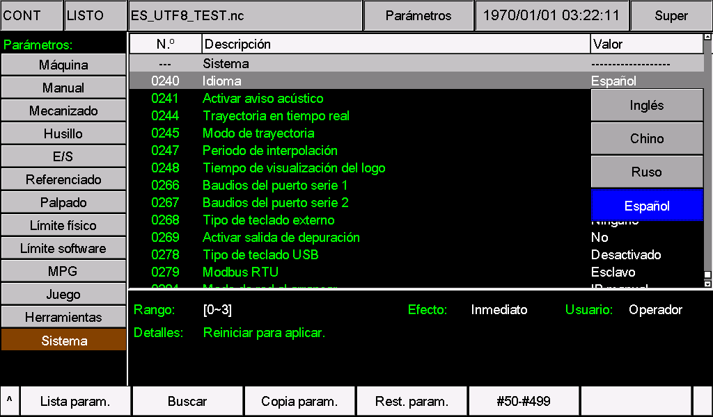
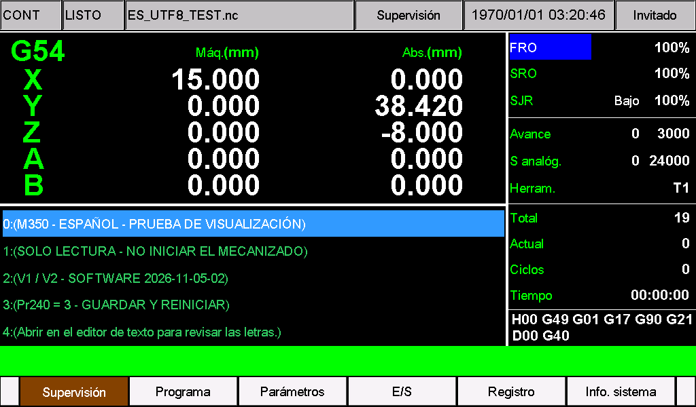
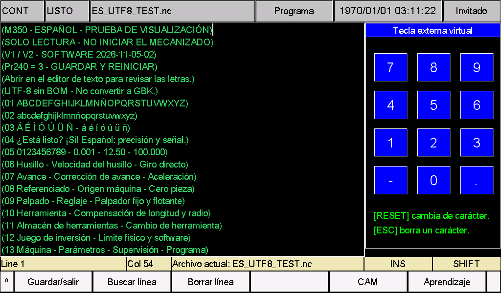

# M350 — Paquete de idioma español

Para **M350 V1 y V2 con software 2026-11-05-02**. Traduce los nombres de parámetros, opciones, ayudas, menús, mensajes y alarmas al español con terminología CNC. Las etiquetas de espacio reducido utilizan abreviaturas. Este paquete solo contiene recursos de idioma; no incluye firmware ni ajustes de máquina.

## Parámetro 240 y codificación

| Pr240 | Idioma y recursos |
| --- | --- |
| 0 | Inglés original: `eng` y `msg1`, con la codificación y la fuente originales. |
| 1 | Chino original: `chs` y `msg`. |
| 2 | Ruso original: `rus` y `msg2`. |
| **3** | **Español al instalar este paquete:** `cfg_utf8` y `msg_utf8`, codificación **UTF-8** y fuente Unicode. |

**Instalar los dos archivos juntos, ajustar Pr240 = 3, guardar y reiniciar.** El valor 3 ocupa la opción de idioma personalizado, antes denominada `Other` u otro idioma. No añade una quinta opción ni permite conservar dos idiomas personalizados en ese puesto.

**Atención: nombres de archivos.** Para mantener la compatibilidad con las versiones del sistema ya publicadas, al usar un idioma adicional (**Pr240 = 3, UTF-8**), los caracteres ingleses de los nombres de archivos se muestran normalmente, mientras que los caracteres no ingleses pueden mostrarse incorrectamente. Utilice letras inglesas sin acentos, números y guiones bajos, por ejemplo `PART_001.nc`, y conserve la extensión. Compruebe los textos de la interfaz y de los parámetros después de instalar el paquete; tenga en cuenta las limitaciones indicadas en esta guía.

## Antes de instalar

1. Detener el mecanizado y mantener la máquina parada durante la instalación.
2. Identificar V1 o V2 y comprobar la versión del software en la información del sistema. Para otra versión, consultar al proveedor y adaptar la traducción a los archivos completos de esa versión.
3. Hacer una copia del disco del sistema, los parámetros y los recursos de idioma. Anotar el valor actual de Pr240.
4. Integrar las modificaciones específicas de la máquina: parámetros, menús CAM, macros y alarmas.

## Identificar V1 o V2

Comprobar la **primera imagen que aparece inmediatamente al encender**:

- **V2:** fondo negro con `V2.0` y `System Loading ...` en blanco. Utilizar la carpeta `psys`.
- **V1:** otra primera imagen de arranque. Utilizar la carpeta `install`.


*Esta imagen sirve para identificar el hardware. Comprobar por separado la versión del software en la información del sistema.*

## Archivos y preparación de la memoria USB

Descargar y descomprimir [M350-Spanish.zip](M350-Spanish.zip).

| Archivo | Contenido | V1 | V2 |
| --- | --- | --- | --- |
| `cfg_utf8` | Nombres, opciones, unidades y ayudas de parámetros | [Archivo V1](V1/install/cfg_utf8) | [Archivo V2](V2/psys/cfg_utf8) |
| `msg_utf8` | Menús, botones, estados, mensajes y alarmas | [Archivo V1](V1/install/msg_utf8) | [Archivo V2](V2/psys/msg_utf8) |

Ambos archivos usan **UTF-8 sin BOM y finales de línea CRLF**. Mantener los nombres exactos, sin añadir `.txt`. Los recursos V1 y V2 tienen el mismo contenido, pero se instalan en carpetas distintas.

**V1:** copiar la carpeta `install` situada dentro de `V1` a la raíz de la memoria USB.

```text
USB/
└─ install/
   ├─ cfg_utf8
   └─ msg_utf8
```

**V2:** copiar la carpeta `psys` situada dentro de `V2` a la raíz de la memoria USB.

```text
USB/
└─ psys/
   ├─ cfg_utf8
   └─ msg_utf8
```

Copiar solo la carpeta correspondiente al hardware. No copiar las carpetas exteriores `Spanish`, `V1` o `V2`; copiar únicamente el ZIP tampoco instala los recursos. Retirar del USB los archivos de actualización antiguos que puedan interferir.

Si el procedimiento de la máquina requiere un paquete completo, sustituir únicamente estos dos recursos en un paquete **de la misma versión de software y para el mismo hardware**. Para cambiar el idioma no es necesario sustituir `setting`, instalar un programa `.out` ni restablecer los valores de fábrica.

## Instalar y seleccionar Español

1. Instalar los dos archivos con el procedimiento habitual de actualización de recursos de la máquina. Esperar a que termine; no interrumpir la alimentación ni retirar el USB durante la actualización.
2. Abrir la página de parámetros y buscar **0240 — Idioma**. Antes del cambio, el nombre del parámetro depende del idioma activo.
3. Seleccionar el **valor 3**. La opción puede aparecer inicialmente como `Other` o con el nombre del idioma personalizado anterior.
4. Confirmar, **guardar y reiniciar el controlador**. Reiniciar aunque el campo general indique efecto inmediato; la ayuda de Pr240 pide reiniciar.
5. Comprobar que Pr240 sigue en 3 y que la opción se llama **Español**. Retirar el USB de actualización.

Si Pr240 ya era 3, instalar ambos archivos y reiniciar para cargar el español. Una actualización completa posterior puede reemplazar estos recursos: volver a aplicar un paquete de idioma compatible con esa versión.



*La opción Español corresponde al valor 3 de Pr240. Guardar y reiniciar; la ayuda indica «Reiniciar para aplicar».*

## Comprobar la visualización



*Pantalla de supervisión de M350 V2 con el paquete español y el archivo de prueba `ES_UTF8_TEST.nc`.*

- Revisar la pantalla principal, los nombres de ejes, los menús, las opciones y la ayuda de los parámetros. No cambiar los valores de máquina para comprobar el idioma.
- Revisar los textos de alarmas existentes, sus números y los campos dinámicos. No provocar alarmas ni movimientos para comprobar textos.
- Confirmar que los valores, unidades, permisos y funciones personalizados se conservan.
- Usar archivos con nombres ASCII y, en modo 3, texto NC en UTF-8. El sistema no detecta automáticamente la codificación del archivo NC. Conservar el original GBK y convertir una copia cuando sea necesario, sin modificar instrucciones, números ni unidades.

La traducción conserva las unidades físicas y las órdenes CNC. Los textos de imágenes, algunos elementos fijos, los comentarios NC y los nombres de archivo no se traducen automáticamente. Este paquete no añade un teclado español ni compatibilidad con emoji o escrituras complejas. Los símbolos disponibles dependen de la fuente instalada.

## Términos y abreviaturas

| Texto | Significado |
| --- | --- |
| Husillo | Spindle |
| Avance | Velocidad de avance programada |
| Referenciado / Ref. | Búsqueda del origen de máquina |
| Cero pieza | Origen del sistema de coordenadas de trabajo |
| Palpado / Palp. | Detección mediante palpador |
| Reglaje | Medición y ajuste de herramienta |
| Comp. | Compensación |
| Juego | Juego de inversión, backlash |
| Máq. / Abs. | Coordenadas máquina / absolutas de pieza |
| Est. | Estado o estación, según el contexto |
| FRO / SRO / SJR | Corrección de avance / de velocidad del husillo / de velocidad manual |
| MPG | Volante electrónico |
| E/S | Entradas y salidas |

## Resolver problemas y volver al idioma anterior

| Situación | Acción |
| --- | --- |
| El idioma no cambia | Comprobar la instalación de ambos archivos, Pr240 = 3, guardar y reiniciar. |
| Caracteres incorrectos o cuadros | Reextraer los archivos originales; comprobar la versión y la codificación UTF-8 sin BOM. |
| Nombres de archivos incorrectos | Usar letras inglesas sin acentos, números y guiones bajos. |
| Desaparece el español tras actualizar | Aplicar los recursos compatibles con la nueva versión del software. |
| Falta una función personalizada | Restaurar la copia y combinar los cambios específicos con el proveedor. |

Para volver a un idioma original, seleccionar en Pr240 el valor 0, 1 o 2 con sus recursos instalados, guardar y reiniciar. Para recuperar otro idioma personalizado, restaurar **juntos** sus antiguos `cfg_utf8` y `msg_utf8` y reiniciar con Pr240 = 3. Si la interfaz no permite operar, seguir el procedimiento de recuperación del proveedor. No restablecer la máquina a valores de fábrica para resolver un problema de visualización.

## Archivo de prueba de visualización

[ES_UTF8_TEST.nc](ES_UTF8_TEST.nc) contiene comentarios en español para comprobar acentos, `ñ`, signos y términos CNC en modo Pr240 = 3. Abrirlo en el editor de texto y desplazarse hasta el final. Es una prueba de visualización sin órdenes de movimiento: **no iniciar el mecanizado**. Mantener UTF-8 sin BOM. Este archivo NC no se instala en `install` ni en `psys` con los recursos de idioma.



*Ejemplo de visualización del archivo en el editor, con acentos, ñ y términos CNC. Solo lectura; no iniciar el mecanizado.*

La nueva documentación se publicará en [https://docs.foinnccnc.com/](https://docs.foinnccnc.com/). Manténgase al tanto de las novedades.
