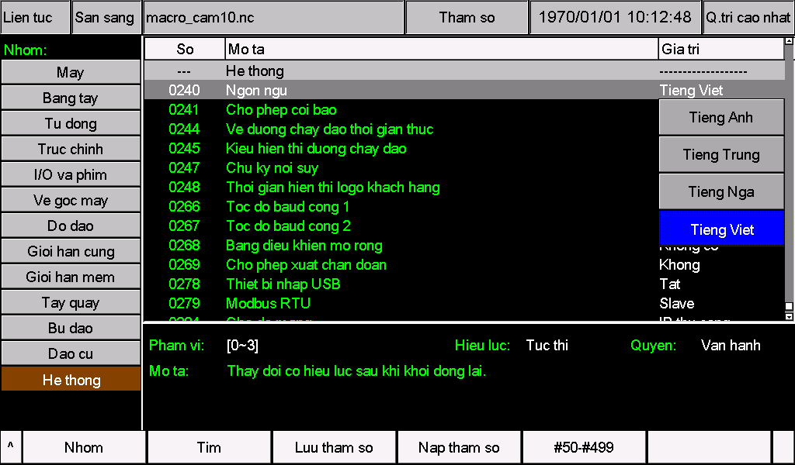
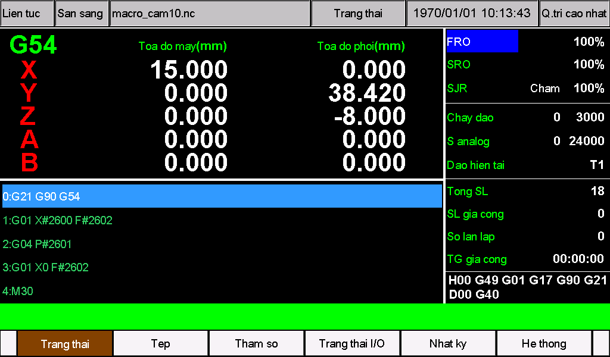

# Gói ngôn ngữ tiếng Việt cho M350

Gói này chuyển tên tham số, lựa chọn, trợ giúp, menu, trạng thái và thông báo của M350 sang tiếng Việt. Các ô nhỏ dùng cách viết ngắn hoặc ký hiệu CNC quen thuộc như JOG, MDI, MPG, F và S.

**Dùng cho M350 V1 và V2, phiên bản phần mềm 2026-10-23-05. Luôn cài cả hai tệp cùng nhau.**

## Cài nhanh

1. Nhận biết phần cứng V1/V2 bằng màn hình đầu tiên khi bật nguồn; kiểm tra phiên bản phần mềm trong trang hệ thống.
2. Sao lưu tham số và các tệp ngôn ngữ hiện có. Nếu máy có nội dung CAM, cảnh báo hoặc tham số tùy chỉnh, hãy tích hợp các nội dung đó trước khi cài.
3. Giải nén ZIP. **Với V1, chép nguyên thư mục `install` nằm trong `V1` vào thư mục gốc của USB. Với V2, chép nguyên thư mục `psys` nằm trong `V2` vào thư mục gốc của USB.**
4. Cài tài nguyên theo quy trình cập nhật đang dùng trên máy.
5. Chọn **tham số 240 = 3**, lưu thay đổi rồi khởi động lại bộ điều khiển.
6. Kiểm tra tiếng Việt và các thiết lập cũ; rút USB cập nhật khi đã hoàn tất.

## Nhận biết V1 và V2

Quan sát **màn hình xuất hiện đầu tiên ngay sau khi bật nguồn**:

- **V2:** nền đen, chữ trắng `V2.0` và `System Loading ...`. Dùng thư mục `psys`.
- **V1:** màn hình khởi động khác. Dùng thư mục `install`.


*Hình này dùng để nhận biết thế hệ phần cứng. Phiên bản phần mềm cần được kiểm tra riêng trong trang hệ thống.*

## Hai tệp dùng để làm gì?

| Tệp | Nội dung hiển thị | V1 | V2 |
| --- | --- | --- | --- |
| `cfg_utf8` | Tên tham số, lựa chọn, đơn vị và trợ giúp | [Tệp cho V1](V1/install/cfg_utf8) | [Tệp cho V2](V2/psys/cfg_utf8) |
| `msg_utf8` | Menu, nút, trạng thái, thông báo và cảnh báo | [Tệp cho V1](V1/install/msg_utf8) | [Tệp cho V2](V2/psys/msg_utf8) |

Giữ nguyên tên tệp, viết thường và không thêm đuôi `.txt`. Hai tệp dùng **UTF-8 không BOM, xuống dòng CRLF**. Nếu chỉ cài đặt, hãy chép nguyên tệp, không cần mở và lưu lại bằng trình soạn thảo.

Gói này sử dụng **vị trí ngôn ngữ tùy chỉnh số 3**. Nếu trước đó vị trí này chứa tiếng Đức, tiếng Hàn hoặc tiếng Bồ Đào Nha, cài hai tệp sẽ thay thế ngôn ngữ đó bằng tiếng Việt. Gói không tạo thêm một mục ngôn ngữ mới.

**Lưu ý về hiển thị tên tệp:** Để duy trì khả năng tương thích với các phiên bản hệ thống đã phát hành, khi dùng ngôn ngữ bổ sung (**Pr240 = 3, UTF-8**), các ký tự tiếng Anh trong tên tệp vẫn hiển thị bình thường; các ký tự không phải tiếng Anh có thể hiển thị không đúng. Hãy dùng chữ cái tiếng Anh không dấu, chữ số và dấu gạch dưới, ví dụ `PART_001.nc`, đồng thời giữ phần mở rộng. Sau khi cài đặt, kiểm tra chữ trên giao diện và các tham số; xem các giới hạn đã biết của gói này.

## Chuẩn bị trước khi cài

- Kiểm tra phần mềm là **2026-10-23-05**. Với phiên bản khác, cần chuyển bản dịch vào bộ tài nguyên đầy đủ của đúng phiên bản; hãy liên hệ nhà cung cấp.
- Dừng gia công và thực hiện cài đặt khi máy ở trạng thái nghỉ.
- Sao lưu tham số, tệp ngôn ngữ và ghi lại giá trị hiện tại của tham số 240.
- Tích hợp nội dung riêng của máy như CAM, thông báo cảnh báo và tên tham số trước khi thay tệp. Chép đè bộ tiêu chuẩn có thể làm mất phần tùy chỉnh đó.
- Đổi ngôn ngữ không yêu cầu tệp `setting`, tệp chương trình `.out` hoặc khôi phục thiết lập nhà máy.

## Chuẩn bị USB

Chỉ chép thư mục phù hợp với phần cứng. Khi mở USB, phải thấy cấu trúc sau:

**V1:**

```text
USB/
└─ install/
   ├─ cfg_utf8
   └─ msg_utf8
```

**V2:**

```text
USB/
└─ psys/
   ├─ cfg_utf8
   └─ msg_utf8
```

Không chép kèm thư mục ngoài `Vietnamese`, `V1` hoặc `V2`. Thư mục `install` hoặc `psys` phải nằm ngay ở gốc USB. Chỉ chép tệp ZIP vào USB thì chưa đủ để cài. Kiểm tra USB để tránh dùng nhầm tài nguyên hoặc chương trình cập nhật cũ còn lưu trên đó.

Nếu quy trình của máy yêu cầu một gói cập nhật đầy đủ, chỉ thay hai tệp ngôn ngữ trong gói **cùng phiên bản 2026-10-23-05 và đúng phần cứng**.

## Cài đặt và chọn tiếng Việt

1. Cắm USB và cài tài nguyên theo quy trình cập nhật của máy. Chờ hoàn tất; không tắt nguồn hoặc rút USB trong khi cập nhật.
2. Khởi động lại theo hướng dẫn của máy, mở trang tham số và tìm **240**. Tên mục có thể vẫn là `Language`, `Sprache` hoặc tên trong ngôn ngữ đang dùng.
3. Chọn **giá trị 3**. Trước khi chuyển ngôn ngữ, mục này có thể hiển thị `Other` hoặc tên gói ngôn ngữ cũ.
4. Xác nhận, **lưu thay đổi rồi khởi động lại bộ điều khiển**. Việc đổi ngôn ngữ cần khởi động lại, kể cả khi ô hiệu lực chung ghi là áp dụng ngay.
5. Mở lại **0240 — Ngon ngu**. Lựa chọn phải là **Tieng Viet**, tương ứng giá trị **3**.



*Ảnh chụp thực tế trên M350 V2: mục `0240 — Ngon ngu` và lựa chọn `Tieng Viet`. Dòng trợ giúp phía dưới nhắc rằng thay đổi có hiệu lực sau khi khởi động lại.*

| Giá trị tham số 240 | Ngôn ngữ |
| --- | --- |
| 0 | Tiếng Anh |
| 1 | Tiếng Trung |
| 2 | Tiếng Nga |
| **3** | **Tiếng Việt khi đã cài gói này** |

Nếu giá trị đã là 3, khởi động lại sau khi cài để nạp các tệp mới. Nếu cần cập nhật cả phần mềm, hãy cập nhật phần mềm trước rồi cài gói ngôn ngữ phù hợp. Một lần cập nhật đầy đủ sau đó có thể thay thế các tệp ngôn ngữ.

## Kiểm tra sau khi cài



*Màn hình chính của M350 V2 sau khi cài gói tiếng Việt. Tọa độ, tên chương trình, số lượng, tỷ lệ tốc độ và đồng hồ trong ảnh là trạng thái của máy lúc chụp, không phải các giá trị cần nhập hoặc thiết lập theo.*

Trước khi tiếp tục gia công, kiểm tra:

- Màn hình chính: tiêu đề tọa độ, menu, trạng thái và các chữ cạnh FRO/SRO/SJR không bị cắt, chồng lên nhau hoặc thiếu ký tự.
- Tham số 240: `Ngon ngu`, `Tieng Viet` và giá trị 3 vẫn đúng sau khi khởi động lại.
- Trang tham số: tên, lựa chọn, trợ giúp, đơn vị và các giá trị thiết lập cũ được giữ nguyên.
- Hộp thông báo: tiêu đề `Thong bao`, nội dung và hai nút `OK`/`Huy` rõ ràng, không có mảng đen bất thường. Chỉ xác nhận về gốc máy khi thực sự muốn thực hiện thao tác đó.
- Lịch sử cảnh báo và trang tệp: số, tên trục và tên tệp đúng vị trí. Không cần cố ý gây cảnh báo hoặc cho trục chuyển động để kiểm tra chữ.
- Các trang CAM: đúng nội dung và còn các phần tùy chỉnh của máy.

Nếu có lỗi, gửi ảnh màn hình, số tham số hoặc cảnh báo, thế hệ phần cứng và phiên bản phần mềm cho nhà cung cấp.

## Thuật ngữ và chữ viết ngắn

| Chữ trên máy | Ý nghĩa có dấu |
| --- | --- |
| Truc chinh / S | Trục chính / tốc độ quay trục chính |
| Chay dao / F | Chạy dao / tốc độ chạy dao |
| Dao | Dao cắt, dụng cụ gia công; không phải chiều quay |
| So dao / So hieu dao | Số hiệu dao, chẳng hạn T1, T2 |
| Phoi | Phôi hoặc chi tiết gia công |
| Toa do may / Toa do phoi | Tọa độ máy / tọa độ phôi |
| Ve goc may | Về điểm chuẩn của máy |
| Dat 0 | Đặt tọa độ hiện tại bằng 0 |
| Bu chieu dai / Bu ban kinh | Bù chiều dài dao / bù bán kính dao |
| Kep / Nha kep | Kẹp / nhả kẹp |
| Tay quay / MPG | Tay quay phát xung điều khiển trục |
| JOG / MDI | Dịch chuyển bằng tay / nhập lệnh trực tiếp |
| FRO / SRO | Tỷ lệ điều chỉnh tốc độ chạy dao / tốc độ trục chính |
| Cham / Nhanh | Chậm / nhanh trong chế độ chạy bằng tay |
| CW / CCW | Cùng chiều / ngược chiều kim đồng hồ |
| IN / OUT | Tín hiệu vào / ra |
| SL / TG / CT | Số lượng / thời gian / chương trình |
| MK / PM / Nha SX | Mật khẩu / phần mềm / nhà sản xuất |
| TT | Trạng thái, dùng trong cột trạng thái I/O |
| LOW / HIGH | Mức logic thấp / cao |
| Thong bao / Huy / OK | Thông báo / hủy / xác nhận |

Phân biệt **về gốc máy**, **về gốc phôi** và **đặt tọa độ bằng 0**: đây là các thao tác khác nhau. Chạy tay theo bước cũng khác chạy từng câu lệnh của chương trình; mô phỏng khác gia công thử điều khiển bằng tay quay.

Ký hiệu trục, mã G/M, đơn vị vật lý, đường dẫn và định danh giao tiếp giữ nguyên cách viết cần thiết. Đổi ngôn ngữ không đổi đơn vị gia công. Thiết lập đơn vị và các lệnh **G20/G21** vẫn có chức năng riêng. Khi nhập số hoặc viết chương trình NC, tiếp tục dùng cú pháp của bộ điều khiển, đặc biệt là **dấu chấm thập phân**.

Gói không bổ sung bộ gõ tiếng Việt cho bàn phím màn hình. Nên đặt tên tệp bằng chữ Latin không dấu, chữ số và dấu gạch dưới, ví dụ `PHOI_001.nc`, đồng thời giữ đuôi tệp. Chú thích chương trình NC, chữ trong hình và một số dòng cố định không được tự động dịch.

## Xử lý lỗi và trở lại ngôn ngữ cũ

| Hiện tượng | Kiểm tra |
| --- | --- |
| Chưa có tiếng Việt | Vị trí thư mục trên USB, cài đặt hoàn tất, 240 = 3, đã lưu và khởi động lại |
| Chỉ menu đổi ngôn ngữ | `cfg_utf8` có được cài đúng vị trí không? |
| Chỉ tham số đổi ngôn ngữ | `msg_utf8` có được cài đúng vị trí không? |
| Tiếng Việt không có dấu | Đây là cách viết tương thích của gói, không phải lỗi mã hóa |
| Ô vuông, mảng đen hoặc chữ lỗi | Giải nén lại cả hai tệp nguyên bản; kiểm tra phiên bản, mã hóa và phần tự chỉnh sửa |
| Chữ bị cắt hoặc chồng lên nhau | Ghi lại màn hình và số mục bị ảnh hưởng; kiểm tra các chữ đã tự thay đổi |
| Mất tiếng Việt sau cập nhật phần mềm | Chuyển bản dịch vào bộ tài nguyên của phiên bản mới |

Nếu vẫn thao tác được, chọn một ngôn ngữ cũ có tệp hoạt động bình thường tại tham số 240, lưu rồi khởi động lại. Để khôi phục ngôn ngữ tùy chỉnh trước đó ở vị trí 3, cài lại cùng lúc hai tệp `cfg_utf8` và `msg_utf8` đã sao lưu rồi khởi động lại.

Nếu không thể thao tác bình thường, dùng quy trình phục hồi tài nguyên của máy với bản sao lưu phù hợp hoặc liên hệ nhà cung cấp. Không thay tham số chuyển động hoặc khôi phục thiết lập nhà máy chỉ để sửa lỗi hiển thị.

Các tài liệu tiếp theo sẽ được đăng tại [https://docs.foinnccnc.com/](https://docs.foinnccnc.com/). Hãy đón chờ.
